<div align="center">

# 👑 CHOG ROYALE

### **Every Chog has a role. Every player has a chance.**

**A chaotic, NFT-aware, real-time 1v1 strategy battler built on Monad.**  
Raise your commander. Build a seven-card squad. Break towers. Survive the Chaos.

[](https://chogroyale.vercel.app)
[](https://github.com/Devendurance/ChogRoyale)
[](https://monad.xyz)
[](LICENSE)

[**🎮 Play**](https://chogroyale.vercel.app) · [**⚔️ Explore the game**](#-how-to-play) · [**🧬 NFT mechanics**](#-the-genesis-connection) · [**🛠️ Architecture**](#-how-it-works) · [**📸 Screenshots**](#-inside-the-arena)

</div>

---

> **You don't need a Chog Genesis NFT or $CHOG to play.** Everyone has access to the core card roster and free commander classes. NFT ownership provides verified identity and collectible-driven experiences, not an automatic stat advantage.

## 🌪️ The world of Chog Royale

Two players. Two sides of the river. A hand of cards. One stubborn Core that absolutely refuses to fall quietly.

**Chog Royale** turns the Chog universe into an original browser-based strategy game. Deploy troops, build defenses, cast spells, time commander abilities, and adapt when the arena suddenly changes its rules. Your choices decide the fight; the server decides what really happened.

The twist? **Real Chog Genesis NFTs influence the match itself.** An indexed Genesis token becomes the **Arena Patron**; its authentic metadata feeds a versioned rules engine that creates **Chaos Pulses** affecting both sides. Verified Genesis holders can also field their own metadata-derived NFT Commander variants.

The game combines approachable free-to-play strategy with an identity-rich social layer: friends, direct messages, clans, progression, commander lending, and Gold-based upgrade sponsorship.

## 📸 Inside the arena

### The world opens here

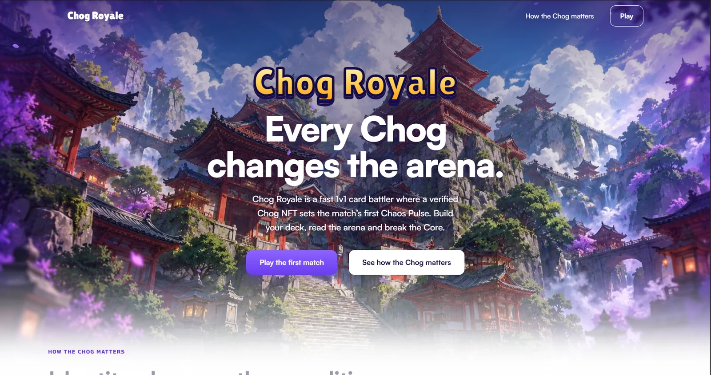

| The battle, in motion | Your squad, your call |
|:---:|:---:|
| 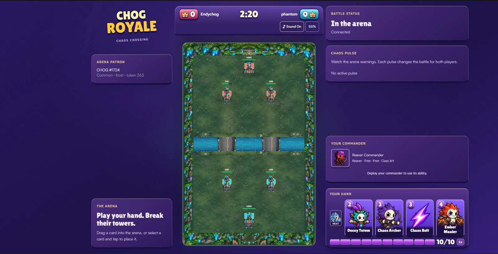 | 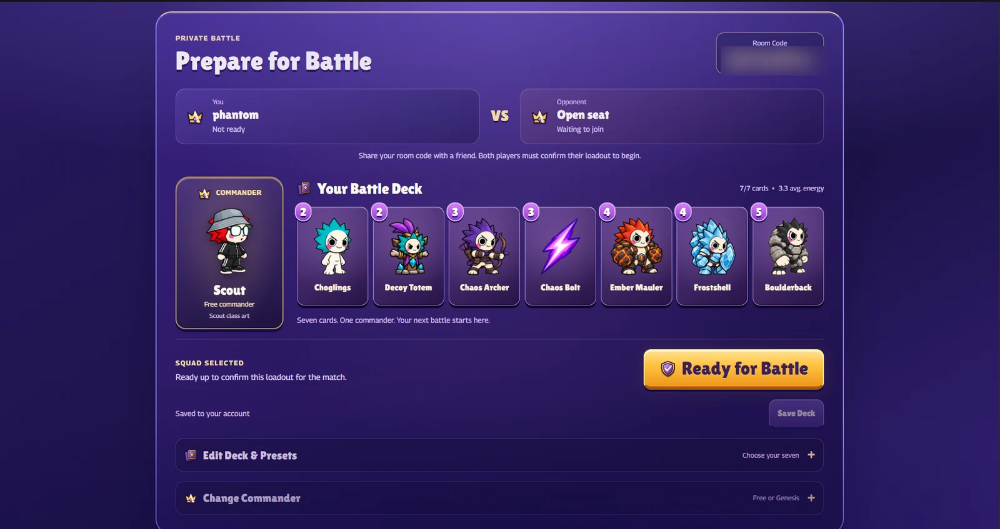 |
| Real 1v1 arena with readable cards, towers and HUD | Seven ordinary cards, one commander, and real ready-up |

| Pocket-sized chaos | The last crown |
|:---:|:---:|
| 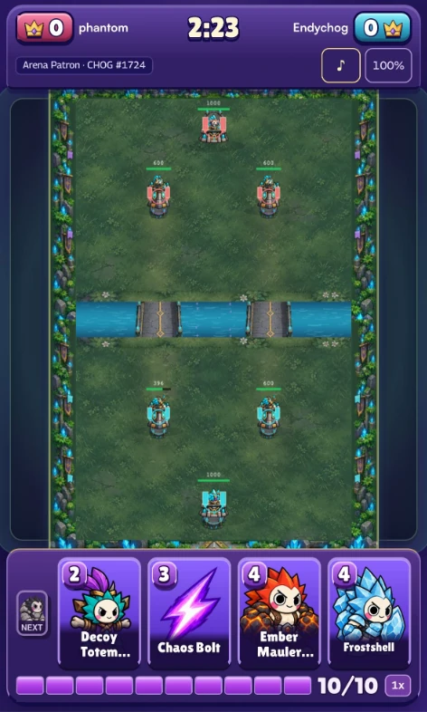 | 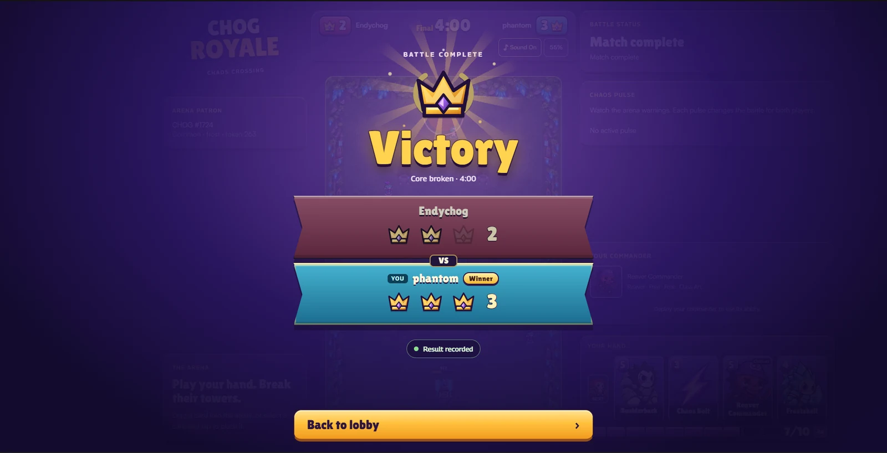 |
| Fully playable card battles on mobile | A cinematic, server-confirmed finale |


> Screenshots are captures of the deployed game at chogroyale.vercel.app, taken by the project owner. The mobile image is a phone capture with the status and browser bars cropped out.

### Around the game

| Commanders | Decks |
|:---:|:---:|
| 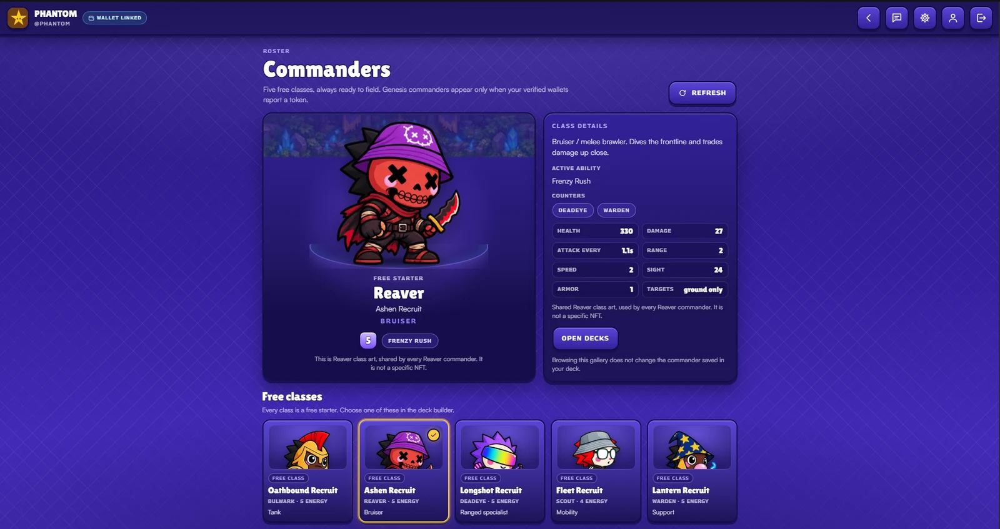 | 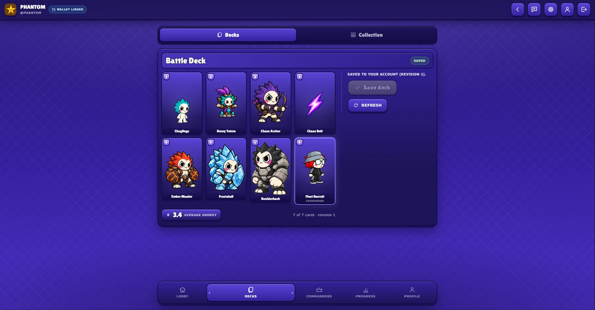 |
| Five free commander classes, shown as shared class art | A saved seven-card deck with its average energy |

| Progress | Friends |
|:---:|:---:|
| 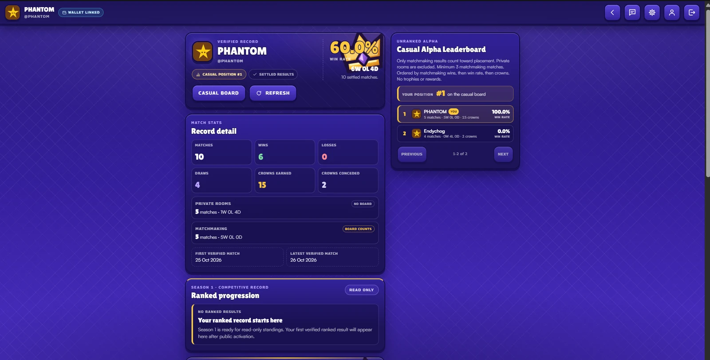 | 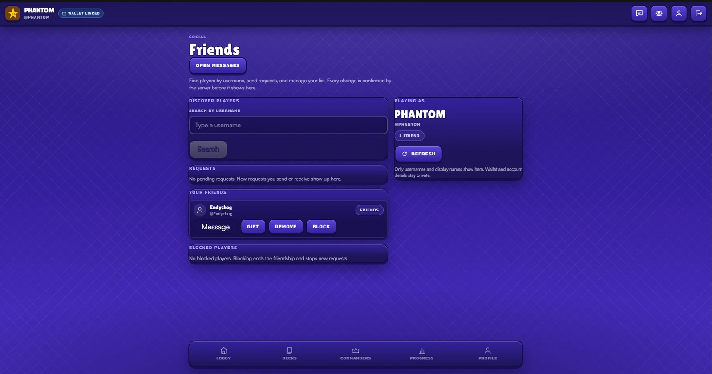 |
| Verified match record and the unranked casual leaderboard | Search players, manage requests, and message, gift or block friends |

| Gifting | Commander lending |
|:---:|:---:|
| 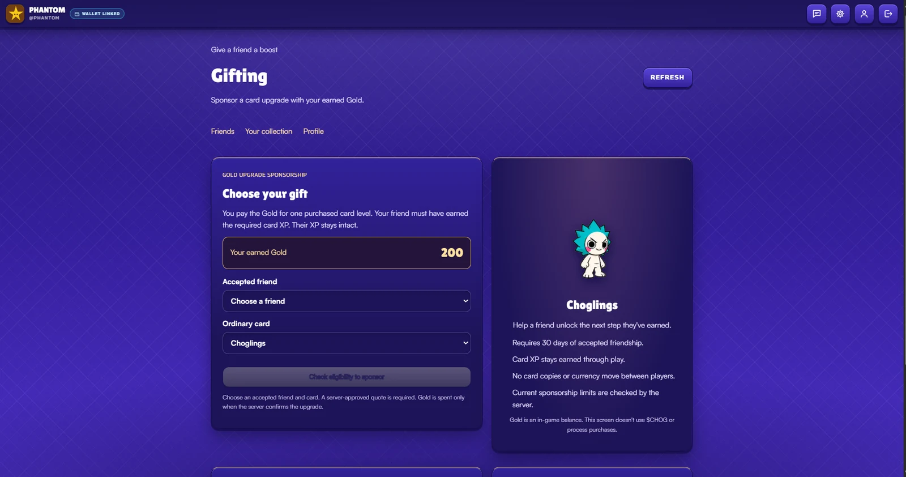 | 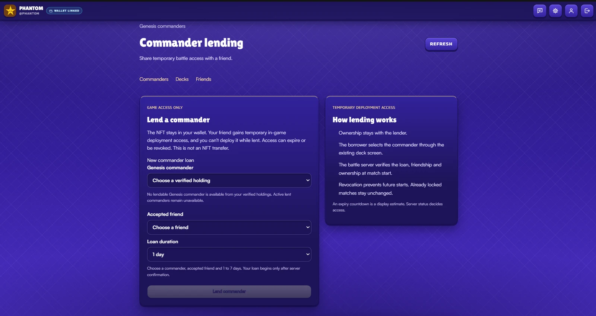 |
| Sponsor a friend's card upgrade with Gold you earned | Lend a Genesis commander for temporary in-game access |

| Clans | Messages |
|:---:|:---:|
| 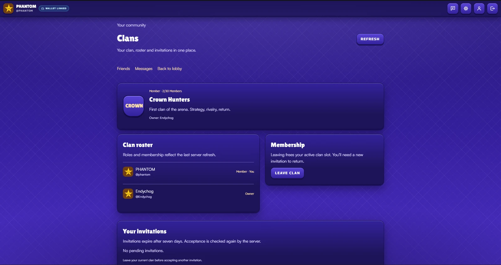 | 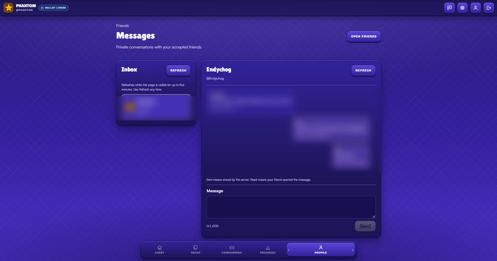 |
| Clan roster, membership and invitations | Private conversations with friends (message text blurred) |

## ⚔️ How to play

1. **Enter the kingdom.** Sign in with Privy, choose your username and avatar, and complete your player profile.
2. **Assemble your squad.** Choose **seven ordinary cards and one commander**. The ordinary roster spans troops, spells, and buildings; the active hand cycles through four playable cards.
3. **Find a rival.** Invite a friend to a private room or enter the casual, unranked queue.
4. **Spend energy wisely.** Deploy into your territory, defend towers, and push across the river and bridges.
5. **Read the Chaos.** The Arena Patron's metadata creates announced, symmetrical Chaos Pulses. What helps you can help your opponent too.
6. **Take their crowns.** Destroy towers or their Core. Celebrate the win—or review the defeat—and build a better deck.

**Battle fundamentals:** real-time 1v1 · tower and Core objectives · cycling card hand · commander abilities · special arena events · reconnect support · server-verifiable outcomes.

## 🧬 The Genesis connection

Chog Genesis isn't just a picture on the profile screen. It supplies **verifiable, game-readable identity** through the Monad blockchain.

### ① NFT Commanders — your Chog, your identity

A linked wallet holding an eligible Chog Genesis NFT can unlock an **NFT Commander**. The game reads authentic token metadata, preserves its original traits, and applies a *separate, versioned* interpretation layer to derive the commander's class, flavor, abilities, presentation, and identity.

- **Authentic inputs:** collection contract, token ID, ownership, metadata URI, content hash, and traits such as `Body`, `Eyes`, `Head`, `Skin`, `Aura`, and `Tier`.
- **Game-authored outputs:** commander class and tactical variation under published rules. These are *derived gameplay properties*, **not claims that NFT metadata itself contains combat stats**.
- **Fairness:** the five class families—**Bulwark, Reaver, Deadeye, Scout, and Warden**—are designed around a competitive power budget. NFT rarity is prestige, not a damage multiplier. Free class commanders remain available.
- **Proof at the boundary:** an NFT choice must pass verified-wallet/chain ownership checks before admission to a battle; loan entitlements are checked separately.

> **Important art distinction:** The standard troops, spells, buildings, and battle cards are **original Chog-inspired game creations**. They are **not automatically generated from each holder's NFT metadata**. Metadata-derived identity belongs to the NFT Commander and Arena Patron systems. The ongoing Blender/3D overhaul develops the game's original character and arena presentation; it does not rewrite the ownership rules.

### ② Arena Patrons — the NFT that changes the battlefield

Before a match, the server selects an eligible, indexed **real Genesis token** as the Arena Patron. Its authentic metadata informs a deterministic configuration:

```text
Verified Chog Genesis NFT
       ↓ token ID + immutable metadata evidence
Arena Patron (theme / Aura / Tier / provenance)
       ↓ versioned rule derivation + server seed
Telegraphed Chaos Pulse schedule
       ↓
Symmetrical changes affecting BOTH players
```

Examples of Chaos families include **Ember Rift, Frost Crossing, Energy Surge, Rift Shift, and Chaos Rally**. A patron's visual/metadata identity influences which conditions arrive; **owning the Patron does not privately grant its owner a match advantage**.

The arena displays the patron's token reference, and match evidence can be linked to the relevant ruleset and verified outcome.

**Chog Genesis collection (Monad):** [`0xc96d31f8626c6d03fae5dcd3d61e3fb9f4a73763`](https://monadexplorer.com/address/0xc96d31f8626c6d03fae5dcd3d61e3fb9f4a73763)  
**Network:** Monad mainnet · Chain ID `143`.

### ③ Commander sharing — lend the role, not the NFT

Want a friend to try your Genesis Commander? Chog Royale implements **temporary, game-scoped commander lending**:

- The NFT **never leaves the owner's wallet**. No custody transfer or ERC-721 approval is part of the loan.
- An eligible friend receives a **temporary in-game entitlement**, currently modeled for **1–7 days**.
- While an entitlement is active, the lender cannot field that commander in Chog Royale; the borrower can use it only while their entitlement remains valid.
- Friendship, blocks, expiration, the linked wallet, and real on-chain ownership are rechecked at relevant use boundaries.

This is **not on-chain renting or staking**. Live NFT-holder acceptance and final production eligibility policy are still release considerations.

## 🪙 Progression: XP, Gold and optional $CHOG

Three systems, three different jobs. **They are not interchangeable.**

| System | What it is | How it works |
|---|---|---|
| **Card XP** | Earned card experience | Eligible verified card deployments contribute toward level requirements, with per-match caps. |
| **Gold** | Off-chain in-game currency | Awarded from eligible verified competitive results and spent on a card's **single-level upgrade**, once sufficient XP is earned. |
| **$CHOG** | External Monad token | A **planned, optional** economy integration for cosmetics and other approved uses. **No live $CHOG checkout or token purchase is claimed here.** |

### Gold is earned, not printed by a friend

The current Gold policy models **60 Gold for a win, 30 for a loss, 40 for a draw** in eligible matchmaking/ranked results; **private rooms award zero**. These values are balance policy and may change. Card XP and purchased levels are tracked separately. Gold spending is recorded in a ledger, so the visible balance is earned minus spent—not a client-editable number.

### Gifting that actually helps

All **20 ordinary cards** are globally available, so gifting a fictional “duplicate card” would do nothing. Chog Royale instead implements **Gold-funded upgrade sponsorship**:

1. Two players meet the friendship eligibility rules (currently 30 days of continuous accepted friendship in the implemented policy).
2. The receiver has already earned the XP needed for their next card level.
3. The sender pays the server-calculated Gold upgrade cost from **their own** balance.
4. The receiver gains **exactly one purchased level**. No XP or Gold transfers between accounts, and the transaction is idempotent and auditable.

The sponsorship implementation and `/app/gifts` UI exist; **production gifting caps and abuse-policy sign-off remain separate from simply having the feature in code**.

### So where does `$CHOG` fit?

$CHOG is part of the **optional economy roadmap**, not a requirement to battle. The proposed first uses include cosmetic profile frames, extra saved deck slots, and potentially a sponsored upgrade funded by a verified token payment. Each would require approved catalog pricing, a verified merchant recipient, chain receipt checks, replay prevention, and explicit launch authorization.

**Candidate $CHOG contract (Monad):** [`0x350035555E10d9AfAF1566AaebfCeD5BA6C27777`](https://monadexplorer.com/address/0x350035555E10d9AfAF1566AaebfCeD5BA6C27777). The codebase's read-only preflight identified the `CHOG` symbol and 18 decimals, but the proxy/implementation and payment configuration require approval before transaction use.

**No NFT or token purchase is needed for standard play. There are no live $CHOG-powered combat boosts, guaranteed earnings, or pay-to-win claims.**

## 🤝 A kingdom is more fun with friends

Chog Royale's social systems are more than usernames beside a leaderboard:

- **Friends & invites** — search players, connect, accept/decline requests, and block unwanted interactions.
- **Direct messages** — player-to-player conversations and read state using authenticated routes.
- **Clans** — create a clan, manage invites, membership, roles, transfers, and departures.
- **Gifts** — quote and sponsor eligible friends' card upgrades with earned Gold, subject to policy gates.
- **Commander lending** — temporarily share a verified NFT commander's in-game use right without sending the NFT.
- **Progress and records** — battle results, XP, Gold, card upgrades, trophy/season foundations, and NFT-linked history.

These systems are implemented across UI and backend to different degrees of launch readiness. **A working screen or route is not a claim that every social flow has completed live production acceptance.**

## 🛠️ How it works

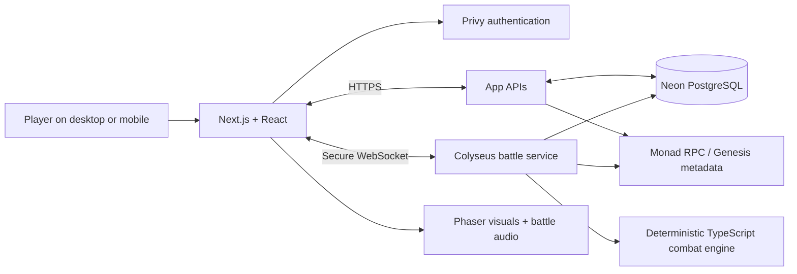

| Layer | Technology | Responsibility |
|---|---|---|
| Web & UI | Next.js 16, React 19, TypeScript, Tailwind CSS | Website, onboarding, decks, profiles, social features and match entry |
| Real-time multiplayer | Colyseus, WebSockets, Node.js | Authenticated rooms, matchmaking, readiness, reconnect and authoritative battle sessions |
| Combat & visuals | Deterministic TypeScript simulation, Phaser | Game rules separated from rendering, input, animation and audio |
| Persistence | Neon PostgreSQL, Drizzle ORM | Profiles, verified outcomes, rewards, friendships, clans, lending and ledgers |
| Authentication | Privy | Player identity and verified wallet linkage |
| On-chain reads | Monad mainnet, viem | Genesis ownership, token metadata and entitlement proof |
| Hosting | Vercel + persistent Ubuntu VPS + Cloudflare Tunnel | Web frontend/APIs and an always-on battle service |

**Trust boundary:** the browser requests actions; **the battle server validates and decides** health, energy, tower damage, score, match results and settlement. The database records verified progression. NFT ownership is checked against the chain, not assumed from a profile picture.

### Repository map

```text
src/app/             Website, authenticated routes, API handlers
src/components/      Site, player-facing, and game UI components
src/lib/             Core rules, NFT metadata, XP/Gold and protocols
src/server/battle/   Authoritative real-time multiplayer and settlement
src/db/             Neon/Drizzle data access
scripts/             Battle-server boot, indexing and audit utilities
drizzle/             Numbered database migrations
public/assets/       Original game art, sprites and battle resources
docs/                PRD, TRD, architecture and implementation notes
```

### Run locally

**Prerequisites:** Node.js 24+, npm, a configured Neon development database and Privy application credentials. The public frontend and long-running Colyseus server are separate processes.

```bash
npm ci
# Create .env.local manually; do not copy real production secrets
```

At minimum, configure the following values privately (never commit actual credentials):

```dotenv
DATABASE_URL=<your-development-neon-connection>
NEXT_PUBLIC_PRIVY_APP_ID=<your-privy-app-id>
PRIVY_APP_SECRET=<your-server-only-privy-secret>
MONAD_CHAIN_ID=143
MONAD_RPC_URL=https://rpc.monad.xyz
NEXT_PUBLIC_BATTLE_SERVER_URL=http://127.0.0.1:2567
```

In two terminals:

```bash
npm run dev
```

```bash
npm run battle:server
```

Then open `http://localhost:3000`. Optional pooled/test DB environment values, production battle-host flags and settlement configuration are documented in the repo's existing configuration and [`docs/P7a-hosting.md`](docs/P7a-hosting.md).

**Do not run `npm run db:migrate` against a production connection string as part of local setup.** Use an isolated development branch and the repo's migration procedures.

### Useful commands

```bash
npm run typecheck       # TypeScript checks
npm test                # Vitest suite
npm run build           # Next.js production build
npm run economy:audit   # Read-only guarded economy audit (configured environment)
```

## 🚧 What is live vs. what is next?

| Capability | Status / scope |
|---|---|
| Privy sign-in, profile onboarding, decks | **Implemented and publicly deployed** |
| Private-room and casual unranked 1v1 battles | **Deployed** with persistent Colyseus; live acceptance continues |
| Arena Patron / symmetric Chaos Pulses | **Implemented** using genuine indexed Genesis metadata |
| NFT Commander derivation and verified entitlement | **Implemented**; real holder scenarios need ongoing acceptance |
| Card XP, Gold ledger, purchased-level upgrades | **Implemented**; rewards subject to eligible-mode and release policies |
| Friends, DMs, clans, gifting UI, commander loans | **Implemented surfaces**; individual production policies and live flows may be gated |
| Ranked matchmaking and trophy progression | **Implemented foundations; public Ranked queue CLOSED** |
| Optional $CHOG checkout / token-paid products | **Planned; NOT LIVE** |
| 3D visual-overhaul V3 | **Active development on a local feature branch; not necessarily deployed** |

Chog Royale is **actively evolving**. The current game and repository may differ while the visual overhaul and staged features are under development. This README intentionally distinguishes working code, public availability, and proposed features.

## 🔒 Fair play, safety and rights

- **No pay-to-win NFT advantage:** free commanders and NFT-derived commanders are bounded by competitive class rules; collection rarity affects prestige rather than unlimited combat stats.
- **No custodial NFT lending:** a loan changes only Chog Royale's temporary use permission; it never transfers the underlying ERC-721.
- **No fake on-chain state:** token identity and ownership are verified; game-derived traits are labeled as game rules.
- **No fabricated rewards:** XP/Gold and match records depend on authorized, verified events, not client claims.
- **Art and brand rights:** Chog Genesis NFT images, collection branding, third-party references and other protected assets remain subject to their respective rightsholders' rights. An NFT or metadata read is **not** a blanket commercial artwork license.

## 🧭 The build story

Built as a full-stack, playable exploration of what happens when **NFT provenance becomes a game mechanic**, not just a collectible badge. From deterministic combat and WebSocket battles to metadata-linked Chaos Pulses and noncustodial commander sharing, the goal is one coherent experience: **original Chog-inspired strategy with proof behind the fun**.

Created and maintained by **[Devendurance](https://github.com/Devendurance)**.

## 📜 License

The project's **original source code** is offered under the [MIT License](LICENSE), subject to rights in third-party components. **NFT artwork, collection trademarks, brand assets, licensed media and other third-party material are not relicensed by MIT merely because they are referenced or included in the project.** Obtain appropriate permission before reusing protected media or branding.

---

<div align="center">

### **Ready to cross the river?**

[](https://chogroyale.vercel.app)

**Bring a deck. Bring a friend. Bring the chaos.** 👑

</div>
