# CHOG ROYALE — Technical Requirements Document (TRD)

**Version:** 1.0 — implementation baseline  
**Date:** 2026-10-10  
**Depends on:** `PRD.md` | **Companion:** `architecture.md`, `projectplan.md`

## 1. Technical objectives and boundaries

Build a production-minded, mobile-friendly real-time 1v1 card strategy game using **Next.js + React + TypeScript + Tailwind**, **Phaser**, **Colyseus with server-authoritative TypeScript combat simulation**, **Privy authentication and wallet linking**, **viem/Monad blockchain reads**, **Neon PostgreSQL + Drizzle ORM**, and a persistent Node runtime for battle servers. No Three.js. Avoid speculative infra complexity; use clean ports/adapters so independently operating AI agents can work in parallel.

**Truth boundaries:**
1. The client submits *intents*, not battle outcomes or world state.
2. Privy authentication proves the app account; wallet control/ownership must be verified separately for protected NFT actions.
3. Monad canonical ERC-721 ownership and NFT metadata determine genuine commander eligibility; cached metadata cannot overwrite current chain ownership.
4. PostgreSQL transactions and constraints are authoritative for persistent entitlements, social relationships, inventories, purchases and rewards.
5. Chog Royale **offchain leasing** creates app-specific gameplay access only. It cannot transfer or encumber the onchain NFT.

## 2. Locked stack and runtime

| Layer | Technology | Responsibility |
|---|---|---|
| UI shell | Next.js App Router, React, TypeScript, Tailwind | SEO/landing, lobby, profiles, decks, social, store |
| Battle rendering | Phaser | Sprite scenes, input, animations, visual effects, audio |
| Multiplayer | Colyseus | Authenticated matchmaking rooms, synchronized state, reconnect |
| Simulation | Pure TypeScript domain engine | Deterministic movement, targeting, combat, spells, Chaos Pulses |
| Identity | Privy React + server-side access-token verification | Email/social, embedded EVM wallet, external linked wallet |
| Blockchain | viem, trusted Monad mainnet RPC/indexer | ERC-721 ownerOf/tokenURI, ERC-20 receipt verification, signatures |
| Database | Neon PostgreSQL, Drizzle, migrations | Players, card state, NFT registry, leases, social and orders |
| Assets | Static/CDN + object storage for user uploads | Sprites, approved NFT art, avatar uploads, generated exports |
| Host | Vercel web; persistent Node.js VPS/container for Colyseus | Separate deploy and scaling domains |
| Test | Vitest/unit, integration DB, Playwright E2E, 2-client multiplayer harness | Regression, deterministic balance, security, smoke checks |

**Mainnet:** Monad chain ID `143`, native gas `MON`, public RPC `https://rpc.monad.xyz` (select monitored reliable provider in production). **$CHOG** published on official Chog site: `0x350035555E10d9AfAF1566AaebfCeD5BA6C27777`. **Genesis collection candidate from marketplace:** `0xc96d31f8626c6d03fae5dcd3d61e3fb9f4a73763` — require official collection verification before allowlist lock.

## 3. Functional requirements by service

### 3.1 Identity / player API
- `AUTH-01` Validate Privy access token server-side on every protected HTTP route and Colyseus join; check issuer/audience/expiry and map DID -> internal `player_id`.
- `AUTH-02` Allow email/social with embedded Monad-compatible EVM wallet and independently linked external wallets. Ownership checks use wallet address with proven control and linked status; do not accept arbitrary user-submitted addresses.
- `AUTH-03` Atomic case-insensitive/normalized unique username reservation, profanity/reserved name checks, rename cooldown and abuse moderation.
- `AUTH-04` Profiles, preferences, avatar selection/upload safety, account linking/unlinking with an active-lease lock warning.
- `AUTH-05` Prevent account merging from silently rewriting current loans or matching records.

### 3.2 Card / inventory / deck services
- `CARD-01` Versioned cards catalog with energy cost, targeting, move speed, hitpoints, attack damage, cooldown, hit radius, projectile/flight tags, rarity and art revision.
- `CARD-02` At least 10 distinct starting troop/spell cards specified in PRD; starters are free.
- `CARD-03` Exactly 8 valid cards per saved deck; validate unique/excluded cards, player inventory where required and season rules.
- `CARD-04` Server calculates energy, hand cycling, placement legality and cooldown; client can't grant cards/XP/trophies.
- `CARD-05` All competitively relevant general cards earnable free; ranked effective stats normalized; spending doesn't create permanent power.

### 3.3 Battle services
- `BATTLE-01` Authoritative Colyseus room has exactly 2 human participants in PvP; bot engine is server-controlled and uses same combat rules.
- `BATTLE-02` Deterministic fixed-timestep simulation; proposed 20 Hz sim tick, 10 Hz network patches, interpolated 60 FPS render target on supported devices. Profile and tune after testing.
- `BATTLE-03` Player commands include `deploy_card`, `deploy_commander`, `cast_spell`, `emote`, and `surrender`; each carries client-generated unique command ID and sequence number; server validates identity, tick window, anti-replay, energy, cooldown, ownership, hand and placement.
- `BATTLE-04` Movement, pathfinding, attack/target acquisition, target immunity, projectile lifecycle, death, tower AI, collision/ability effects and tie resolution exist in reusable pure domain engine.
- `BATTLE-05` Server seeds any randomness; store seed, combat rules version and command/event log for replay and adjudication.
- `BATTLE-06` Colyseus room handles join, reconnect, grace period, timeouts, forfeit, disconnects, concurrent reconnect and duplicate client sessions.
- `BATTLE-07` Each match snapshots deck/card stats, verified commander entitlement and arena patron event profile at admission; onchain/lease changes deny subsequent admission, and may finish the current bounded match unless moderation forces abort.
- `BATTLE-08` Persist final match result exactly once; update ratings/trophies, rewards, profile history, patron appearances and stats through an idempotent transaction/outbox.
- `BATTLE-09` Practice, friend and ranked match results carry explicit mode; only eligible human PvP contributes to lender trust threshold.
- `BATTLE-10` During RTC failure/instance restart, no client claims an arbitrary win; use persisted periodic checkpoints/recovery where enabled or controlled `void_no_rewards` with clear notification. No phantom rewards.

### 3.4 NFT provenance / trait engine
- `NFT-01` Only configured `(chain_id, contract_address)` and existing tokens are recognized. Chain must be `143` for production Genesis.
- `NFT-02` Read ERC-721 owner using `ownerOf(tokenId)` from trusted chain view; obtain metadata using `tokenURI` or authorized indexer; validate type/schema/size and sanitized image URI. Handle IPFS/HTTP/unavailable metadata and missing traits safely.
- `NFT-03` Cache metadata (with content hash, fetched block, version, fetchedAt) but **do not use cached owners as final authority for lending**.
- `NFT-04` Trait mapping rules registry is deterministic and versioned; unknown values map to documented defaults; changes introduced by explicit seasons, not mid-match.
- `NFT-05` Match Patron selected with auditable random policy from verified token pool, frozen for match and shown in UI; server displays token ID, trait subset, exact event effect.
- `NFT-06` Owner commands derive from actual metadata; nonholder Rookie Commander is fair ranked alternative.
- `NFT-07` Commander legacy records tied to immutable composite token key, player attribution and battle IDs; current holder never inherits another player's trophy count.
- `NFT-08` Chain RPC/indexer failure denies new sensitive NFT entitlements but doesn't halt free battle modes.

### 3.5 Friends and lending
- `FRIEND-01` Accepted mutual friendship has persisted `accepted_at`, `broken_at`; any unfriending/blocking causes eligibility interruption/reset (new acceptance starts a new 30-day tenure).
- `FRIEND-02` Eligibility: >= 30 *continuous* 24h friendship; each >= 30 anti-fraud-qualified human PvP matches, at least 10 on distinct days (defaults); no sanctions/suspicious patterns; must meet owner/token checks.
- `LEASE-01` Lender holds token in verified wallet at offer creation and recipient acceptance; offer requests are constrained to 1–7 whole days, pending TTL <= 24h.
- `LEASE-02` Offer includes explicit human-readable typed EIP-712 authorization bound to chain, NFT collection/token, lender wallet, lender and borrower account IDs, duration, nonce, expiry, application domain and `rules_version`. Verify signer via viem `publicClient.verifyTypedData` (cover EOAs and smart contract accounts as supported).
- `LEASE-03` An authenticated recipient must accept, revalidate all conditions and create durable active entitlement atomically.
- `LEASE-04` Exactly one pending/active lease per `(chain, contract, token)`; borrower can use at most one leased commander at once; lender at most two concurrent lent tokens by default. Lock while transitioning, never rely on UI state.
- `LEASE-05` While active, authenticated lender cannot deploy NFT commander, recipient can. Do not revoke the lender's underlying wallet/NFT badge or pretend NFT ownership moved.
- `LEASE-06` Lease ends automatically at expiry, on verified owner transfer, friendship break/block, moderation action or approved mutual cancellation; leased entitlement disabled and owner reenabled only when chain owner still matches.
- `LEASE-07` Status changes use an auditable append-only event record. Expiry must be calculated from server time (`now() >= ends_at`) **even if scheduled workers are delayed**.
- `LEASE-08` Lending never calls `approve`, `setApprovalForAll`, `safeTransferFrom`, `transferFrom` or deploys a wrapper token; no wallet custodial action.
- `LEASE-09` Concurrent acceptance, expiry, sale, session refresh, chain read outage and replayed signatures covered in negative tests.

### 3.6 Social / progression / economy
- `SOC-01` Friend requests, accept, remove, invitation, block/unblock, profile privacy and presence.
- `SOC-02` DM/global/clan chat gated by verified session, rate limits, content sanitization, flood protection, reports and admin moderation; never permit strangers to circumvent blocks.
- `SOC-03` Card gift/request with duplicate-only rule, anti-farm caps, transactional inventory debit-credit and ledger records; no NFT/commander transfer through card gifts.
- `SOC-04` Clans/roles/permissions, clan chat and opt-in events with no pay-based battle stat gains.
- `PROG-01` Quests, XP and trophies derived from signed-off authoritative results. Season versioning supports changes without historical score corruption.
- `PAY-01` Public $CHOG payments use owner-signed wallet tx, supported ERC-20 on correct chain, server-verified transaction receipt, destination, amount, decimals and unique fulfillment.
- `PAY-02` Nonholder catch-up offers only cards available via free gameplay; everyone may purchase cosmetics; ranked has no paid-only power advantage.
- `PAY-03` Reorg/finality handling and exactly-once fulfillment ledger, refund/safety operator tooling, caps and rate limits. No secret admin mint authority in client.
- `MOD-01` Chat/report/sanction service can block abuse, void fraudulent matches and invalidate illegitimate leases with reviewable reasons.

## 4. Domain model and database contract

Use UUID PKs for app entities; use `privy_did` unique external identity. All rows have timestamps (`timestamptz`) and critical audit provenance. Token addresses canonicalized/lowercase in DB but displayed with checksum in UI. Use `numeric(78,0)`/decimal-string for onchain uint256 token IDs/amounts; **never JS `number` for token/amount precision**.

| Table / aggregate | Required fields / uniqueness |
|---|---|
| `players` | id, privy_did UNIQUE, username_key UNIQUE, display_name, avatar_url, created_at, sanctions |
| `wallet_links` | player_id, chain_id, address, verified_at, linked_identity_ref, active; unique canonical wallet ownership policy |
| `friend_requests` | requester_id, recipient_id, status, created_at, resolved_at |
| `friendships` | canonical ordered pair UNIQUE, accepted_at, broken_at; history retained for tenure |
| `player_blocks` | blocker_id, blocked_id UNIQUE, created_at |
| `card_catalog` | card_key, version, class, rarity, rules JSON schema + safe stats |
| `player_cards` | player_id, card_key, quantity; UNIQUE pair; transaction-safe balance |
| `decks` + `deck_slots` | owner, mode, version; eight slots with UNIQUE position and validated cards |
| `player_stats` | player, season, rank, trophies, qualified_pvp_matches, qualified_days; derived counters with audits |
| `matches` | mode, room_id UNIQUE, state, patron key, rules_version, seed, started_at, ended_at, outcome, idempotent result key |
| `match_players` | match_id, player, deck snapshot, commander snapshot, result, score/trophy delta |
| `match_events` | match_id, seq, tick, input/result digest (bounded retention) |
| `nft_metadata` | chain_id, contract, token_id UNIQUE, tokenURI, metadata_hash, traits_json, source_block, rules_map_version |
| `nft_ownership_checks` | token key, owner, block number/hash, observed_at, source, confidence/status |
| `nft_legacies` | token key UNIQUE, total appearances, win counts, achievement records |
| `commander_profiles` | token key + ruleset_version UNIQUE, class, ability set, balance budget, metadata_hash |
| `lease_nonces` | signer wallet + nonce UNIQUE, consumed_at, challenge_expires_at |
| `commander_leases` | id, token key, lender_player_id, borrower_player_id, wallet, signature_hash, status, offered_at, accepted_at, starts_at, ends_at, reason, version |
| `lease_events` | lease_id, seq, actor, old/new status, reason, chain_ref, occurred_at (append-only) |
| `entitlement_projection` | token key UNIQUE, active_player_id, entitlement_type, lease_id nullable, version, expires_at |
| `chat_messages` | room, sender, normalized body, moderation status, sent_at, retention policy |
| `clans`/`clan_members` | clan IDs, roles, state, membership uniqueness |
| `card_gift_ledger` | unique transfer ID, donor, recipient, card, quantity, state, idempotency |
| `store_offers`/`orders`/`payment_receipts` | chain/token/recipient/amount/receipt validation, unique chain tx + log index, fulfillment ledger |
| `outbox_events` | aggregate, event type, payload, processed_at, attempts, dead-letter |
| `reports`/`moderation_actions` | reporter, subject, evidence, outcome, audit |

**DB integrity requirements:** FKs, checks, lease duration checks, no negative inventories, `CHECK (lender_player_id <> borrower_player_id)`, unique username normalized key, `(chain_id, collection, token_id)` unique metadata key, a **partial unique index** that permits no more than one `commander_leases` in `pending_acceptance`/`active` for same token, and outbox uniqueness/idempotency. For terminal leases, historical duplicate token keys are fine.

Sample invariant SQL (adapt table/column names with migrations):

```sql
CREATE UNIQUE INDEX commander_leases_one_live_token
ON commander_leases (chain_id, collection_address, token_id)
WHERE status IN ('pending_acceptance', 'active');

CREATE UNIQUE INDEX unique_completed_match_result
ON match_results (match_id, player_id);

ALTER TABLE commander_leases
ADD CONSTRAINT lease_distinct_players
CHECK (lender_player_id <> borrower_player_id);
```

**Race handling:** lock a dedicated `nft_token_locks` row using `SELECT ... FOR UPDATE` per `(chain, contract, token)` while making lend/accept/expire decisions; do not use a non-locking `count(*)` precheck as the only guard. For per-player quotas, additionally lock player quota rows in sorted ID order. Recheck source of truth after locks; retry serialization failures with bounded backoff.

## 5. Commander entitlement algorithm

Decision `canEquipOrDeploy(playerId, tokenKey, matchContext)`:
1. Validate active authenticated account, no sanction, verified owning/borrowing permission.
2. Check exact chain + allowlisted collection and known metadata/rules version.
3. Check active lease by **server time**. If active: only `borrower_player_id` may equip; if not active: only currently verified owner-linked player may equip.
4. On new match admission, perform ownership freshness check (and chain finality policy) for any NFT commander; in-progress battle uses immutable snapshot as described in PRD.
5. Check commander slot, already-deployed constraint, stats budget and room profile; return a signed server-internal entitlement decision (not trusted client signature).
6. Append audit decision/failure reason for important protected operations.

**Periodic transfer invalidation:** subscribe to ERC-721 `Transfer` logs through trusted provider/indexer with reorg backfill, then reconcile `ownerOf` on eligible blocks. Every fresh lease acceptance and ranked admission uses direct/latest-trustworthy owner proof with a bounded cache TTL plus explicit transfer-observation invalidation. On transfer, atomically mark lease invalidated, revoke new admissions and recalc owner entitlement; old owner cannot keep using it. If chain reads fail, pending sensitive admissions pause rather than trusting stale cached ownership.

## 6. Public HTTP API contract (proposed version `/api/v1`)

All protected endpoints require Privy access token, rate limits, request size checks and schema validation; public GET endpoints avoid leaking wallet/private friend info.

| Method / route | Purpose | Notes |
|---|---|---|
| `POST /players/onboard` | Create/upsert internal player | Privy DID from verified token only |
| `PUT /players/me/username` | Claim/rename unique handle | Atomic normalized uniqueness |
| `GET /players/me` | Player profile, linked wallets | Private response only |
| `GET /cards/catalog` | Versioned cards | Cacheable |
| `GET/PUT /decks/:id` | Fetch/replace deck | Schema + entitlement validation |
| `POST /matchmaking/tickets` | Request rank/friendly/practice match | Auth token + rules version |
| `GET /matches/:id` | Result/Patron and public history | Authorization for detailed inputs |
| `GET /chogs/me` | Owned eligible NFTs and commander profiles | Revalidate stale ownership |
| `GET /chogs/:tokenId` | Metadata provenance + legacy | Collection-scoped and cached |
| `GET /friends` | Friends, tenure and invitation state | Block/privacy aware |
| `POST /friends/requests` | Invite player | Spam and impersonation controls |
| `POST /friends/:id/accept` | Accept invitation | Establish accepted_at |
| `POST /friends/:id/block` | Block | Immediately breaks loan eligibility |
| `GET /leases/eligibility?friendId=...&tokenId=...` | Explain conditions/reasons | No private anti-fraud thresholds leak |
| `POST /leases/challenge` | Obtain nonce + EIP-712 payload | Owner auth and wallet proof |
| `POST /leases/offers` | Submit signed lending offer | Atomic uniqueness; signature validate |
| `POST /leases/:id/accept` | Borrower accepts within TTL | Locked ownership + eligibility recheck |
| `GET /leases/me` | Active/pending/history | Authz enforce owner/recipient only |
| `POST /leases/:id/mutual-cancel` | Two-sided consent workflow | Two approvals recorded |
| `GET/POST /social/messages` | DM/global messages | Safe scoped permissions |
| `POST /cards/gifts` | Atomic eligible duplicate gift | Anti-farm limits and idempotency |
| `GET /store/offers` | Mode-allowed products | Nonholder catch-up filters |
| `POST /orders` | Issue immutable priced quote | Server trusted amount/recipient |
| `POST /orders/:id/verify` | Confirm onchain ERC-20 payment | Verify exact receipt/log/chain; no blind tx hash acceptance |
| `POST /reports` | Player/message/match report | Audit trail |

Use structured errors: `{ code, message, requestId, retryable?, details? }`; avoid revealing anti-cheat scoring to clients. Version API and shared schema package.

## 7. Real-time room protocol

**Room:** `ranked_v1`, `friendly_v1`, `practice_v1` using Colyseus (`onAuth`/custom verified token), participant identity and match admission guard.

**Client intents:**
```ts
type DeployIntent = {
  type: 'deploy_card';
  commandId: string; sequence: number;
  cardKey: string; lane: 'left'|'right';
  x: number; y: number;
};
```

**Server-synced `BattleState`:** tick, phase, countdown, energy per side, beacon/core HP, compact entities (IDs, type, position, HP, target/animation cues), hand/deck private views, Patron public reveal, pulses, result. Hide unplayed card/private future hand from opponent. Commands are idempotent and may be dropped/replayed by network; sequence+ID prevent double deployments. Use interpolation for visuals, never render-client predicted damage as authoritative.

**Simulation:** engine receives normalized `GameState` and typed `GameCommand`; returns new state+events. Pure deterministic engine avoids browser/network dependencies and wall-clock side effects. Server alone advances ticks. Order events deterministically (e.g., `(tick, playerSeat, commandSequence)`), seed pseudo-RNG explicitly. Use collision/path rules fixed for season. Log combat version for replay consistency.

## 8. Lease state machine and validation

```mermaid
stateDiagram-v2
  [*] --> Eligible
  Eligible --> PendingAcceptance: owner signed offer
  PendingAcceptance --> Active: borrower accepts; guards pass
  PendingAcceptance --> Expired: TTL elapsed
  PendingAcceptance --> Invalidated: ownership/friendship/sanction changed
  Active --> Expired: end time reached
  Active --> Invalidated: transfer/block/fraud/moderation
  Active --> Cancelled: both parties consent
  Expired --> [*]
  Invalidated --> [*]
  Cancelled --> [*]
```



**EIP-712 typed authorization (conceptual fields; implement exact ABI/types and versioned domain):**

```ts
const domain = {
  name: 'Chog Royale Commander Loan',
  version: '1',
  chainId: 143,
  verifyingContract: undefined, // offchain typed authorization: no deployed rental contract
};
// Include app-origin or stable app identifier IN the signed message;
// a missing verifyingContract means domain+message must robustly bind app identity.
// Message: collection, tokenId (uint256), lenderWallet, lenderPlayerId,
// borrowerPlayerId, durationSeconds, nonce (bytes32), deadline, rulesVersion.
```

Implementation must not accidentally encode `verifyingContract: undefined` as a Solidity address. If possible, use a stable EIP-712 salt/app identifier and an explicit backend-readable terms display. Validate contract wallet signatures through public `verifyTypedData` rather than only EOA recovery. Signatures are never reusable for another token, borrower, chain, duration or offer, and nonce is consumed atomically. A browser cannot extend a lease by editing `endsAt`.

**Transition pseudocode:**

```text
acceptLoan(authenticatedBorrower, leaseId):
  begin transaction (serializable)
  lock lease and token-lock row; lock quota rows in deterministic order
  assert pending, offer TTL active, borrower == authenticatedBorrower
  assert accepted friendship age >= 30 days (unbroken)
  assert both players have 30 eligible PvP + 10 distinct qualifying days
  assert neither blocked/sanctioned; quota available
  assert offchain authorization signature + consumed nonce belong to offer
  fetch fresh canonical owner proof; assert owner == lender verified wallet
  assert no other pending/active lease for token
  set status=active, starts_at=db_now, ends_at=db_now + signed_duration
  update entitlement projection to borrower; append lease event and outbox
  commit
```

Note: an external RPC call should ideally occur just before opening the DB lock, then be revalidated for freshness/block anchor at commit; keep transaction network blocking bounded. Protection from an onchain transfer occurring after proof but before DB commit requires chain event reconciliation and deny-new-match admission until verified. There is no globally atomic transaction across Monad and Postgres, so document/monitor this unavoidable boundary rather than claiming perfect synchrony.

## 9. Security, abuse and privacy

**Threats and mitigations**
- Forged wallet ownership -> server `ownerOf` + wallet link proof, ERC-721 collection allowlist.
- Forged login or expired Privy JWT -> server token validation on HTTP and websocket joins.
- Lease signature replay -> nonce table, typed bindings, deadlines, single-consumption.
- Loan race/double use -> DB uniqueness, token locks, transactional entitlement update, room admission check.
- Chain transfer during lease -> Transfer event processor + owner reconciliation + fail-closed admission.
- Fake wins / farming -> authoritative server results, eligible PvP accounting, opponent-diversity signals, minimum duration/activity and manual fraud review.
- Cheating card/energy/HP -> trusted server sim, action sequence/rate/placement checks, replay digests.
- Websocket flooding -> connection/command rate limits, per-player concurrent room limits, payload size cap.
- Chat spam/grooming/hate/harassment -> block/report, moderation queue, word/rate filters, safe defaults, retention/deletion policy.
- $CHOG false receipt/double spend -> verify transaction chain, token, Transfer log, `to`, amount and confirmation policy, unique fulfillment.
- Admin token/key leakage -> secrets only server, least-privilege env, rotate credentials, no private signing secrets committed.
- NFT image/metadata injection -> strict URI schemes, safe CDN/proxy, escaping, file size and MIME constraints.
- Operational outage -> explicit downtime UI; free-play can stay available if chain RPC is unavailable; never silently grant loan rights.

User privacy: only reveal necessary addresses with consent; don't expose email/social account IDs; keep chat logs only as long as the safety policy requires. Provide visible report/block mechanisms and clear account/data deletion route consistent with records that must be retained for dispute/audit.

## 10. Nonfunctional targets / observability

**Engineering targets, not unverified guarantees:** p95 gameplay command-to-ack < 200ms under target test-region load; room state sync ~10 Hz; 60 FPS rendering on capable target devices and graceful fallback; < 2% unplanned aborted match rate in staging; 99.5% API availability objective once observed; initial reconnect grace 30 seconds; server time is authoritative.

Log requestId, `matchId`, `roomId`, `playerId` (not PII), `leaseId`, `tokenKey`, rules version, chain block height and transaction hash. Metrics: concurrent rooms, tick overrun, patches/sec, matchmaking wait, join/reconnect failures, command rejects, match completion, discrepancies between NFT owner/cache, lease expiry lag, double-use deny counts, social reports, payment fulfillment lag.

Monitoring includes error alerts, structured logs, db query timings, battle room health endpoint, RPC timeout budget and outbox backlog. Schedule Neon backups/restore rehearsal and DB migration rollback plans; do not put synchronous Neon queries inside each simulation tick.

## 11. CI/test matrix and acceptance evidence

**Unit:** card and commander stat budgets; damage resolution and target priority; path graph; pulse symmetry; deterministic seeded replay; normalized ranked power; username normalization; lease duration/30-day boundaries.

**Integration with test Neon branch:** real SQL unique index transaction races; inventory ledger consistency; offer nonce consumption; acceptance/expiry/transfer invalidation; cross-account authorization; matching result persistence and leaderboard idempotency.

**Chain adapter tests:** mock + mainnet read-only checks against publicly verified NFT `ownerOf`/metadata, wrong collection, missing trait, wrong chain, invalid 1271 signature, Transfer indexer retry/reorg, RPC outage fail closed.

**Multiplayer E2E:** two Playwright contexts with independent identities; troop deployment/energy/HP parity, Chaos Pulse timed events, disconnect/reconnect, auto-bot, surrender/draw and no duplicated match result. Run tests with fake clock for deterministic timings.

**Social/store:** concurrent duplicate gifting, self-trading, blocked DM, spam throttling, payment tx replay, reverted ERC-20 transaction, underpayment, incorrect recipient/chain.

**Release gates:** typecheck + lint + relevant tests + production build + deployed paired-browser smoke; privacy/auth/security negative tests; visible battle video and real player feedback; not just UI screenshots.

## 12. Configuration and secrets

Expected environment variable categories (actual names may be adapted during implementation):

```dotenv
# client-exposed: ONLY nonsecrets
NEXT_PUBLIC_PRIVY_APP_ID=
NEXT_PUBLIC_MONAD_CHAIN_ID=143
NEXT_PUBLIC_GAME_WS_URL=
NEXT_PUBLIC_GAME_API_URL=

# private on backend
DATABASE_URL=
PRIVY_APP_SECRET=
MONAD_RPC_HTTP_URL=
MONAD_RPC_WS_URL=
CHOG_GENESIS_CONTRACT=      # must be officially validated
CHOG_TOKEN_CONTRACT=0x350035555E10d9AfAF1566AaebfCeD5BA6C27777
INTERNAL_API_HMAC_SECRET=
ASSETS_BUCKET_CREDENTIALS=

# server-configured policy
LEASE_FRIENDSHIP_DAYS=30
LEASE_REQUIRED_PVP_MATCHES=30
LEASE_REQUIRED_PVP_ACTIVE_DAYS=10
LEASE_MIN_DAYS=1
LEASE_MAX_DAYS=7
LEASE_PENDING_HOURS=24
```

Store private secrets in deployment secret manager; no wallet private keys are needed for basic NFT lending. If contract-writes enter scope for store settlement, user signs and pays directly; don't create a custodial hot wallet by default.

## 13. Technical verification and dependency links

- Privy tokens and verification: https://docs.privy.io/authentication/user-authentication/access-tokens
- Privy connect-or-create wallet: https://docs.privy.io/wallets/connectors/usage/connect-or-create
- viem public smart-account typed-data verification: https://viem.sh/docs/actions/public/verifyTypedData
- Colyseus authoritativeness: https://docs.colyseus.io/
- Colyseus reconnect: https://docs.colyseus.io/room/reconnection
- Neon/Postgres operational sizing: https://neon.com/docs/manage/endpoints/
- ERC-4907 (reference only): https://ercs.ethereum.org/ERCS/erc-4907
- Monad official developer network: https://github.com/monad-developers/
- Chog official site: https://chog.xyz/

**External uncertainties to resolve in code:** exact SDK signatures are version-specific; use current installed APIs, verify collection/traits directly, verify official usage rights to artwork, check ERC-721 ownership behavior on supported RPC, confirm $CHOG decimals and transaction flow. The architecture is a specification, not a claim that the game or lending contracts are currently deployed.
