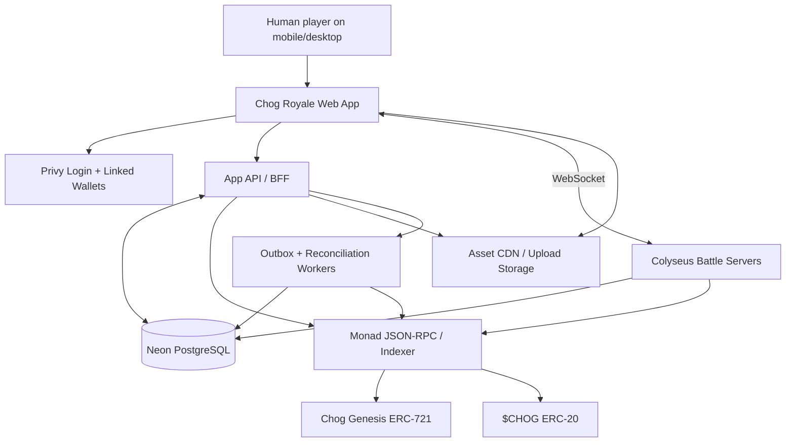
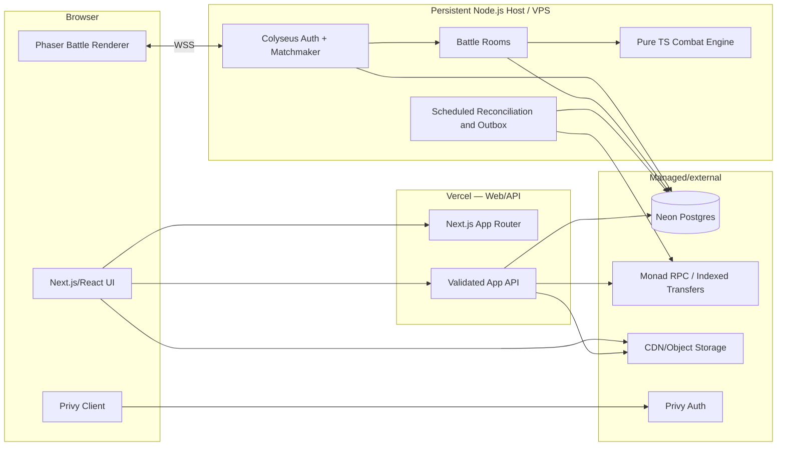
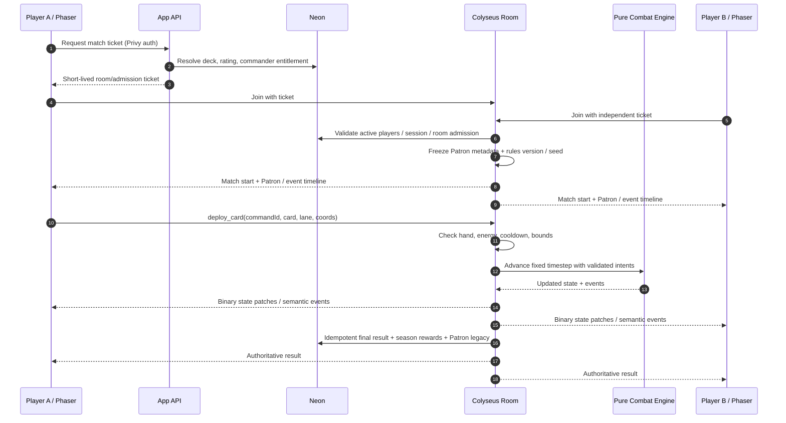
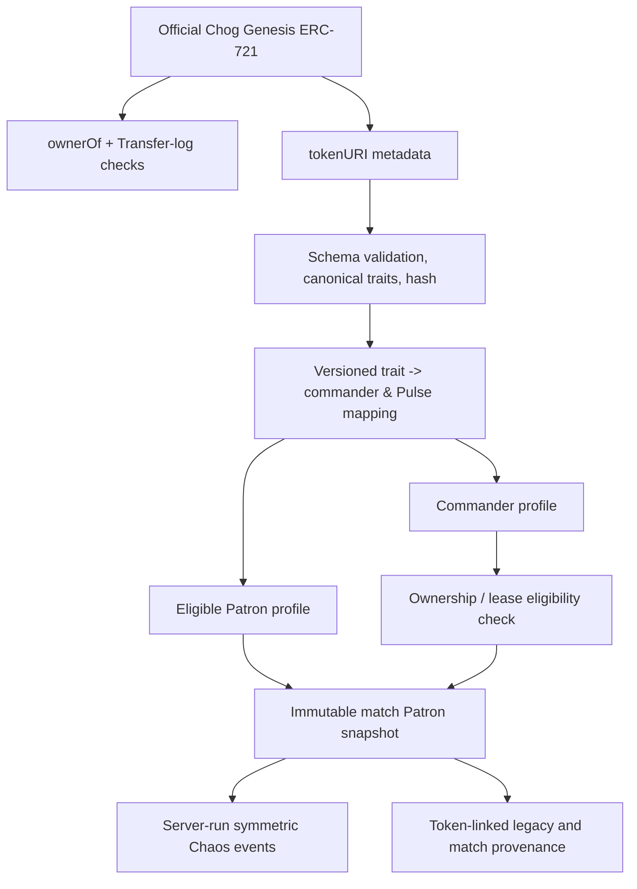
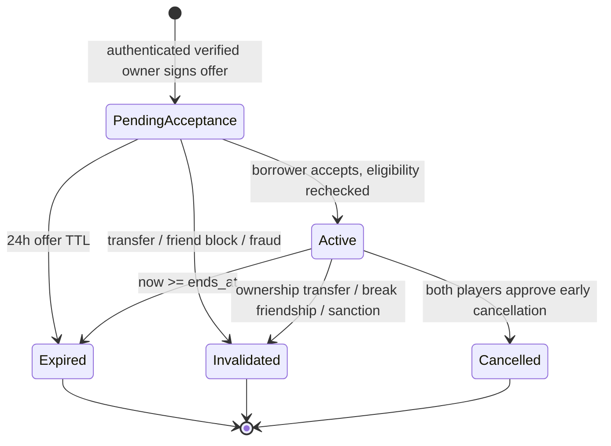
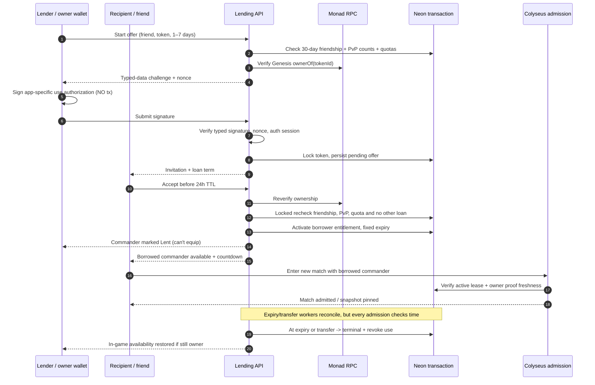
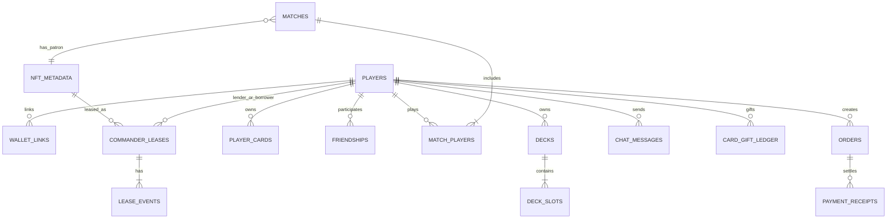

# CHOG ROYALE — System Architecture

**Version:** 1.0 — implementation baseline  
**Date:** 2026-10-10  
**Related:** `PRD.md` · `TRD.md` · `projectplan.md`

## 1. Architectural intent

Deliver a polished **real-time 1v1 web battler** with 100% authoritative combat and meaningful **Chog Genesis NFT-derived rules**. Support a social MMO-like surrounding shell—identity, friends, chat, clans, gifting, rankings and optional $CHOG spending—without putting those slower, persistent workloads in the hot combat loop. Implement **offchain non-custodial NFT commander lending** with strong provenance, transactional exclusivity, expiry and transfer invalidation.

Architecture principles:

1. **Combat server owns simulation.** Phaser is renderer/input, not source of health, damage, currency or victory.
2. **One shared TypeScript domain model.** Cards, event effects, commander trait mapping, and match results use versioned schemas consumed consistently by UI/tests/server.
3. **Separate hot and cold paths.** Match ticks stay in game-process memory; Neon handles durable player data and match snapshots/results, never queried on every tick.
4. **One app identity, explicit chain proofs.** Privy DID authenticates player; Monad `ownerOf` authenticates NFT title; a signed lending authorization and app state govern use-rights.
5. **No NFT custody.** Lending is an exclusive entitlement enforced only inside Chog Royale. No approval or transfer of Genesis tokens.
6. **Safe integration and independent agents.** Bounded packages/contracts permit parallel feature work; avoid editing the same core interfaces without coordination.

## 2. Context view



**Who trusts whom?** The browser is untrusted for game, loan and payment actions. Privy validates account session, **not** NFT ownership. Monad is authority for NFT title and confirmed token transfers. Neon is authority for friendship and app-specific commander use-rights. Colyseus is authority for live combat.

## 3. Containers and deployment topology



- **Vercel**: static marketing pages, authenticated lobby, profile, deck, store/social screens and API handlers. Do not rely on an ordinary short-lived request handler for the always-running match tick loop.
- **Persistent VPS/host**: Node/Colyseus behind TLS reverse proxy at `wss://...`, one service initially. Start with a process manager/container restart policy, health probes, graceful shutdown, environment-scoped secrets and structured logs.
- **Neon**: system of record, transaction-level correctness, development/staging branches, migrations. Pick region near the game host. Pool connections in long-running Node services; choose appropriate Neon driver for serverless API.
- **Asset storage**: static authored sprites can ship from app/CDN; store optional user-uploaded avatars safely in R2/S3-compatible storage. External NFT art is displayed only within confirmed licensing and content-security rules.
- **Monad RPC**: use trusted primary+fallback endpoints; capture block number/hash, token URI, chain identity; reconcile `Transfer` events and block reorgs. Public RPC limits are not a sound sole production dependency.
- **Privy**: authenticate via token validation in both API and Colyseus entry. A linked EVM wallet may be different from embedded default wallet; all owned NFT addresses must be explicitly verified.

## 4. Recommended repository boundaries

```text
chog-royale/
  apps/
    web/                        # Next.js UI, Phaser integration, client SDKs
      src/app/                   # landing, lobby, arena, cards, social, vault
      src/components/            # UI components, scenes, art/view adapters
      src/lib/api/               # typed REST client
      src/lib/battle/            # Phaser scene, input translation, netcode view
    game-server/                # persistent Colyseus server
      src/rooms/                 # ranked, friendly, practice room orchestration
      src/auth/                  # trusted admission and player identity
      src/services/              # match settlement, room management
    worker/                     # lease expiry, NFT transfer reconciliation, outbox
  packages/
    game-core/                  # pure deterministic combat sim and rules
      src/cards/                # card definitions and behavior policies
      src/arena/                # map graphs, towers, movement and targeting
      src/pulse/                # arena Patron event policies
      src/commander/            # normalized stat budgets, traits -> abilities
      src/sim/                  # tick loop independent of Phaser
    contracts/                  # Zod/schemas/types for HTTP and room messages
    database/                   # Drizzle schema, migrations, DB tests
    identity/                   # Privy server guard, wallet link policy
    chain/                      # viem reads, collection metadata, receipt checks
    leasing/                    # domain service + entitlement state machine
    social/                     # friendships, chat policy, gifting, clans
    payments/                   # quote/verification/fulfillment domain
    config/                     # gameplay configs, feature flags, env validators
  assets/                       # source art, licensing manifest, exported sprites
  docs/                         # ADRs, runbooks, traces, challenge evidence
  tests/e2e/                    # Playwright two-browser journeys
  .github/workflows/            # CI matrix
```

`packages/game-core` never imports the DOM, Phaser, DB, viem, Next.js or Colyseus. Ports/adapters mean it can run in tests and headless bot simulations, with Phaser merely translating server state/events into animation.

## 5. Battle: sequence, timing and trust



### Simulation invariants
- **Proposed fixed tick**: 20 Hz; network patches around 10 Hz; adapt with performance tests. Use monotonic server tick as the only simulation timebase.
- **Game state**: `matchId`, `tick`, `phase`, 2 player seats, HP/energy, hand/deck/cooldown, entities, tower targets, queued pulses, Patron metadata hash and ruleset.
- **Determinism**: use seeded RNG for relevant random events, stable tie-breaking order for events and unit IDs, quantized/controlled math if cross-runtime deterministic replay matters. Current combat engine runs server-side only; full lockstep client simulation is not required.
- **Client intents**: authorized per participant; validate card exists in frozen deck, in hand, energy sufficient, placement legal, rate and sequence legitimate. Dedupe command IDs.
- **Visibility**: server sends opponent only data allowed by information rules (e.g., hides upcoming deck order and private matchmaking identities).
- **Reconnection**: preserve seat for configurable 30 seconds; emit disconnected status; on valid reconnect, send full authoritative snapshot and continue. A failed reconnect resolves as explicit forfeit or no-contest according to server state.
- **Match settlement**: insert immutable result once with deterministic `matchId` idempotency key; transactional trophy/XP adjustments and outbox event for downstream notifications.
- **Outage**: never infer victory from a client timeout alone; if server crashes without durable outcome/recoverable checkpoint, record no-contest and no rewards.

### Battle rules
Core: 3 min + 30-sec max overtime, 8-card decks and 4-card hand, 10 energy cap, ten starting units/spells, two lanes/bridges, side Beacons, central Core, symmetric Chaos Rift. Definitions live in immutable `ruleset_version` so client/UI/server all receive same numbers; changes ship as new profile/season.

## 6. NFT provenance and the metadata-to-play pipeline



**Specific verified metadata fields from marketplace listings:** `Aura`, `Background`, `Base`, `Body`, `Eyes`, `Form`, `Head`, `Mouth`, `Naked`, `Side`, `Skin`, `Tier`; individual tokens can include extras like `Accessory`. The source **does not specify HP/damage/abilities**. We generate them in a controlled and versioned mapper.

**Source of truth distinction:**
- Existence/current title: `ownerOf(tokenId)` at a trusted/confirmed chain height.
- Visual/static traits: fetched token metadata after schema validation and canonical JSON/hash.
- Ability assignments: published product mapping `traits-rules-vN` and the card/stat budget.
- Match behavior: frozen verified token metadata + active `ruleset_version` recorded with result.
- Gameplay right: owner if not leased, otherwise valid borrower, never both.

**Patron selection policy (proposed):** maintain validated allowlisted Genesis token pool. Seed from a server-generated random input committed before matching (or verifiable deterministic hash of match/session seed). Derive index uniformly. Freeze patron+effect for match; show to both players at same time. Neither payer nor an NFT whale can bias ranked selection. If a token cannot be verified or metadata can't be resolved, retry with another real token and log the reason; no synthetic/randomly fabricated token substituted.

**Artwork/licensing:** link real token collection and show metadata. Rights to display/project NFT artwork commercially are not inherent in holding NFT; confirm with Chog team and artists. Maintain asset licensing manifest; if approval isn't in place, use original in-house battler art and text trait labels while retaining verified metadata mechanics.

## 7. Commander lending architecture (no token transfer)

**Data model:** each token keyed by `(chainId, collection, tokenId)`; persistent loan has `lender_player`, `borrower_player`, verified `owner_wallet`, status, signed EIP-712 payload hash, nonce, offered/accepted/starts/ends timestamps, event history, policy version, chain proof. `entitlement_projection` is an optimization; final server decision always uses lease state + time + fresh ownership policy.

### 7.1 State machine



### 7.2 Sequence of temporary use rights



### 7.3 Lease rules and race-proofing

- **30 days** means a continuously accepted mutual relationship, measured from the latest valid `accepted_at`; blocking/unfriending interrupts and resets clock.
- **30 qualified human PvP battles each** plus at least **10 distinct eligible play days** each are launch defaults; rankings from practice bots, obvious farms, quickly-aborted and fraud-voided matches do not count.
- Signed offer has immutable recipient, token, duration, deadline and nonce. Only the recipient can accept; signature replay/cross-app reuse rejected; support EOA and ERC-1271 where viem tooling permits.
- `one_pending_or_active_lease_per_token` is enforced with a partial unique index. Lock NFT token row, lease, and lender/borrower quota rows in sorted order within SQL transaction; transaction time is canonical.
- During active lease, owner remains the onchain NFT owner but cannot start matches with that NFT commander; borrower can until expiry/transfer and can't reshare it.
- A transferred NFT invalidates app use-rights; recognize asynchronous onchain-to-DB reconciliation limitations. Validate fresh ownership on offer, acceptance and ranked admission. Fail closed for new NFT-dependent entry on RPC outage.
- If transfer occurs midmatch, **no new admissions/deployments outside frozen match rights**; a snapshot-authorized ongoing match can finish within the 210-second cap, except abuse/moderation override. This protects match integrity while promptly ending future access.
- Lease expiry is enforced synchronously by `NOW()`, not solely by scheduled cleanup. Sweep workers update records, projections, notifications, and user interfaces.
- In-app mutual early cancellation records both consents; the token holder cannot promise seven days then revoke in-app arbitrarily. They **can** still sell/transfer token onchain, which voids app lease and must be communicated to borrower upfront.

### 7.4 ERC-4907 decision
ERC-4907 is a documented NFT rental interface with an expiring `user` role. It is **not required** here. We do **not** assume Chog Genesis implements it, and cannot modify the existing NFT contract to inject it. Our software implements narrowly scoped game-server entitlements, not onchain transferable/collateralized rights. Introduce a separate contract only if later requirements demand trust-minimized ecosystem-wide delegation and the NFT ecosystem supports it.

## 8. Persistent app services

### Identity service
Uses Privy access-token verification to authenticate requests, maps DID to internal UUID, safely stores linked wallet metadata, verified ownership refresh and permission checks. Login and wallet connection are separated: a wallet merely *connected for viewing* is not automatically an authorized NFT-lending signer.

### Social service
`friend_requests` + `friendships` with accepted-at tenure and immutable history; blocks immediately prevent DM and invalidate loan eligibility. Chat threads/global/clan messages require contextual ACL and moderation; use PostgreSQL persistence for launch, WebSocket/subscription gateway for online updates (may reuse dedicated nonbattle realtime service, not noisy combat rooms). If live chat traffic grows, add broker/Redis later.

### Cards and gifting service
Card catalog/owned quantities/decks persisted in Neon. Gifts are transactional debit+credit ledger moves with rate, duplicate-only, allowed-item and block/friend-policy validation. To prevent laundering, make gifting nontransferrable for sensitive paid/unique assets.

### Economy/payment service
Server creates an immutable $CHOG-denominated order quote with offer ID, correct token/chain/recipient/amount, expiry and idempotency. Player pays via their wallet. Processor watches confirmed receipts + Transfer logs, verifies exact to/amount/token and unique tx/log before fulfillment ledger grants items. Don't trust supplied screenshot or tx hash in isolation. Handle partial payment, wrong chain, cancellation and reorg without granting duplicates. No financial return promises.

### Ranking/analytics service
Only sealed match outcomes adjust trophies, seasonal ranks and player stats. Record honest telemetry: actual players, completed matches, return sessions, NFT patrons, usage and feedback. Logs must never fabricate claims for hackathon submission.

### Worker/outbox
Processes transfer reconciliation, lease expiry and invalidation, notifications, reward settlement and retries. Simple Postgres outbox polling is sufficient at initial scale. Workers are idempotent and monitor lag; scale queues/brokers only when operationally justified.

## 9. Data model topology



Detailed columns/constraints are in `TRD.md`. Primary guarantees include unique username key, unique player Privy DID, unique wallet/token keys, one live lease per NFT, exactly-once match settlement, unique payment log fulfillment, and append-only audit ledger. Normalize large Ethereum integers as decimal strings / `numeric(78,0)`.

## 10. API and protocol separation

- **HTTPS app API**: player identity, wallet, NFTs, decks, social/DM, gifting, lending, shop and match history. Version prefix `/api/v1` and typed schemas in `packages/contracts`.
- **WSS Colyseus protocol**: room authentication, matchmaking, input commands, battle state diff, live events, reconnect. Never expose unrestricted arbitrary server state mutation.
- **Background chain consumer**: indexed ERC-721 Transfer logs, owner refresh, ERC-20 confirmed payments, reorg reconciliation. It has no direct browser entry point.
- **Internal game->DB/service**: game room owns authoritative match result, emits sealed settlement event once. Admin tools protected by server-only scopes, audit logs and least privilege.

**Representative response shape:**

```json
{
  "tokenKey": "143:0xc96d...:846",
  "entitlement": "borrower",
  "leaseStatus": "active",
  "expiresAt": "2026-10-15T17:30:00Z",
  "rulesVersion": "season-1-v1"
}
```

This is an illustration of JSON shape, **not** a claimed real active lease. `tokenKey` formatting and endpoints must match versioned contract schemas.

## 11. Security boundaries and operational controls

| Boundary | Main control |
|---|---|
| Browser -> App API | Privy JWT verify, Zod validation, CSRF controls where cookie auth, rate limiting |
| Browser -> Game | Short-lived room ticket, Privy identity binding, room seat/auth checks, command validation |
| Game -> DB | Parameterized queries, least privilege roles, idempotent settlement |
| App -> Monad | Known chain ID/contract, verified ownership/receipt and block context |
| Lending -> Token | **No ERC-721 transfer or approval methods**; signature conveys Chog Royale-only use |
| Social -> Players | Block/mute/report/retention, scoped private data |
| Store -> Entitlement | Server receipt verification, unique tx log and order fulfillment constraints |
| Admin -> User records | Privileged access + audit + reviewable reasons |

**Data protection:** store only needed social identifiers, encrypt sensitive secret materials, disclose which wallets are linked, hide sensitive linked info publicly, protect upload processing. Chat moderation is necessary before unrestricted global launch. Accessibility, mobile responsiveness and abuse reporting are product release gates, not decorative polish.

## 12. Scaling path (without premature infrastructure)

**Phase A (initial):** one persistent Colyseus service on VPS, stateless Vercel frontend/API, Neon, simple Postgres outbox, CDN. Track CPU/tick overruns, DB connection use, WSS concurrency and p95 latency. Provide health checks and uptime monitoring.

**Phase B (usage-driven):** separate matchmaker/room nodes; presence/chat as own realtime service; Redis presence and Colyseus distributed coordinator when parallel nodes needed; horizontal worker scaling and stronger event stream; CDN optimization.

**Phase C:** multi-region rooms with region-aware matchmaking, queue fairness, persisted replay/event store, dedicated anti-cheat pipeline, feature flag/experiment platform, managed deployment.

Do not assume VPS is already configured for this project or that a specific number of users will fit without load tests. The current design intentionally keeps scaling seams visible rather than deploying unused clusters on day one.

## 13. Verification / failure-mode runbooks

**RPC slow/down:** disable NEW NFT-based leasing and commander admissions, use safe retry/fallback endpoints, show player-facing explanation; keep standard nonholder/practice modes working. Reconcile ownership and pending offers after recovery.

**Game-server restart:** stop matching, gracefully settle/notify active rooms where possible; on unavoidable crash mark no-contest rather than create phantom victories. Monitor repeated restarts.

**Lease sweeper delayed:** requests still use synchronous time comparison; jobs catch up projection + notifications. Test expiry while worker is paused.

**Friend unblocks/re-friends:** require new 30-day tenure, no restoration of prior active loan. Verify against latest friendship era ID.

**Onchain transfer reorg:** don't treat unconfirmed/unstable transfer data as permanent without reconciliation; maintain block hashes, re-read current `ownerOf`, repair entitlement projection and audit correction. Prefer conservative fail closed for new matches during uncertainty.

**Duplicate payment confirmation:** unique chain transaction/log/fulfillment keys block second grant; return existing order result.

**Fraud farm:** mark suspect matches ineligible, review with audit evidence, recalculate player trust counters transactionally; invalidate leases if current threshold not legitimately met under moderation policy.

## 14. Architecture decision records (ADRs)

| ADR | Decision | Rationale |
|---|---|---|
| 001 | Phaser, not Three.js | 2D/2.5D asset/control pipeline for quick polished battle |
| 002 | Colyseus, not raw Socket.IO | Built-in room lifecycle, synced state, reconnect and matchmaking |
| 003 | Neon + Drizzle, not Supabase bundle | PostgreSQL system of record; separate Privy/Colyseus already selected |
| 004 | Privy + verified external wallet | Accessible nonholder onboarding, real holder proofs |
| 005 | Server-authoritative deterministic TypeScript | PvP fairness, replay/anti-cheat and agent-testability |
| 006 | Offchain signed app-specific loans | No expensive NFT transfers or unsupported collection contract change |
| 007 | Equalized ranked stats | Prevent NFT wealth / $CHOG spending from determining wins |
| 008 | Match Patron from actual NFT metadata | Makes NFTs consequential for all players and challenge alignment |
| 009 | Persistent match server | Predictable real-time tick and connection lifecycle |
| 010 | Postgres outbox first | Idempotent reliable workflows without unused distributed infra |

## 15. Unverified assumptions / source checks

- **Official Genesis contract:** marketplace token pages suggest `0xc96d31f8626c6d03fae5dcd3d61e3fb9f4a73763`; confirm via Chog team/official material prior to privileged production flows.
- **NFT art license:** public metadata does not automatically establish a right to commercially reproduce all art in a game. Obtain Chog team's permission/terms.
- **$CHOG decimals and transfer behavior:** verify live ERC-20 contract and RPC, don't assume decimals or fees from name alone.
- **Wallet signing APIs:** verify against pinned Privy/viem versions. EIP-712 typed data is recommended; supporting smart wallets needs explicit viem contract signature tests.
- **ERC-4907:** docs describe rental interface; do not imply the current Genesis ERC-721 supports it.
- **Competition:** full rules, prizes, deadline and judging taken from supplied official hackathon brief; any evolving organizer requirements must be reconciled before final submission.

**References:** https://docs.colyseus.io/ · https://docs.colyseus.io/room/reconnection · https://docs.privy.io/authentication/user-authentication/access-tokens · https://viem.sh/docs/actions/public/verifyTypedData · https://neon.com/docs/manage/endpoints/ · https://ercs.ethereum.org/ERCS/erc-4907 · https://chog.xyz/ · https://opensea.io/collection/chog-genesis · https://github.com/monad-developers/
