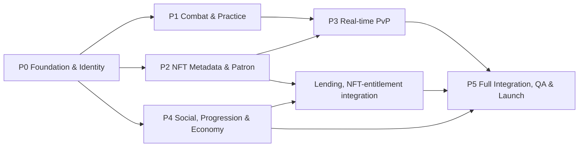

# CHOG ROYALE — Agent-Orchestrated Project Plan

**Version:** 1.0 — execution baseline  
**Date:** 2026-10-10  
**Product/technical source of truth:** `PRD.md`, `TRD.md`, `architecture.md`  
**Delivery philosophy:** Build the complete game through parallel specialist agents. **Six bounded milestones** are integration checkpoints, not arbitrary limits on how much can be shipped during the hackathon.

## 1. What is locked

- Product: **Chog Royale**, a distinctive Chog-powered real-time **1v1 lane-and-card strategy game**, not a copy of another game's protected UI/art/character design.
- Stack: Next.js/React/Tailwind/TypeScript; Phaser visuals; Colyseus authoritative match rooms; Neon PostgreSQL + Drizzle; Privy auth; viem + Monad; persistent Node host for multiplayer; no Three.js.
- Combat: two-lane **Chaos Crossing**, two Beacons + Core per side, 8 cards in deck/4 in hand, 10 starter troop/spell cards, energy, short real-time matches, 1 equipped commander, ranked normalization.
- NFT novelty: real verified **Chog Genesis** metadata maps to **Arena Patron** and symmetric telegraphed **Chaos Pulses**, plus owner-only personalized commanders and token-linked legacies.
- Accessibility/fairness: nonholders play for free and can win ranked; NFT ownership/rarity/count and $CHOG spending do not confer uncapped ranked stat advantage.
- Economy: nonholder catch-up card acquisition through optional $CHOG (all relevant cards also earnable free); cosmetic uses for everyone; onchain receipt verification, no hidden lootbox/wagering.
- Community: identity, unique display name, avatar, friends, safe DMs/global chat, blocks/reports, clans, card requests/gifts, leaderboards and seasons.
- Friend-to-friend commander loan: **30 days continuous friendship**, **30 verified PvP battles each** and **10 different play days each** by default; owner signs 1–7-day authorization, recipient explicitly accepts, NFT remains in lender wallet, borrower alone may use it inside game until lease expiry/invalidations. Owner can still sell onchain; transfer invalidates game loan. Loan not a token sale/rental and does not call ERC-721 approvals/transfers.

## 2. Deliverables and product surface map

**Web application:** landing, onboarding, authenticated lobby, profile, NFT Vault, live arena, deck collection, friend directory, chats, clan surface, seasonal ladder, quests, optional store, admin moderation.

**Game:** original visual asset collection (10 units/spells + commanders, Beacons, Core, particles, audio), input/drag, deterministic simulation, bot practice, friend and ranked 1v1, authoritative match results/reconnect.

**NFT system:** verified collection registry, trait mapping and previews, patron pipeline, permanent token-linked history, owner/borrrower entitlement and noncustodial loan flows.

**Backend:** Privy auth guard, API routes, Colyseus server, Neon schema/migrations, social/gift/store domain logic, anti-abuse, outbox and chain transfer/receipt workers.

**Submission evidence:** deployed link, repo/tech documentation, reproducible testing instructions, up-to-three-minute demo video, verified Chog NFT rule demonstration, product/usage feedback (actual numbers only).

## 3. Agent team structure and contracts

Operate agents in independent git worktrees/feature branches and merge via contract/test gates. One coordinating agent owns shared schemas and integrations; no parallel agent should overwrite another's working directory changes.

| Stream / Agent | Owns | Can start | Must integrate with |
|---|---|---|---|
| A. Foundation / integration lead | Workspace, shared TypeScript config, CI, contracts, env, migrations, cross-stream PR review | Immediately | All |
| B. Combat domain | Pure tick engine, cards, AI, pathing, energy, win conditions, tests | Immediately after minimal shared contracts | C, D |
| C. Game/client art | Phaser scenes, battle renderer, animations, touch UI, sprites, audio | Immediately with fixture state | B, F |
| D. Multiplayer | Colyseus rooms, matchmaking, reconnect, anti-cheat, settlement | After first contract schema | B, E |
| E. NFT + leases | Monad adapter, trait mapping, Patron, holder commanders, signing, loan DB/state | Immediately after auth/DB interfaces | B, D, G |
| F. Product UI / identity | Next.js, Privy, username, lobby, profile, decks, NFT Vault | Immediately | A, C, E |
| G. Social + economy | Friends, chat/moderation, clans, gifts, quests, $CHOG store/fulfillment | After DB/auth contracts | E, F |
| H. QA / DevOps / demo | CI smoke, database/chain test harness, hosting, observability, user test, demo | Immediately and continuously | All |

If agent capacity is smaller, combine adjacent workstreams but preserve ownership boundaries. A coordinating agent can prioritize branch integration while others build. Agent-led speed is welcome, but **completion means end-to-end live functionality**, not only code generation.

### Working rules for agent sessions

1. Read `PRD.md`, `TRD.md`, `architecture.md`, this plan and current relevant repository implementation; scout only when current state is actually unknown.
2. Work from a scoped acceptance list. Reuse existing code/modules and stop rebuilding completed capabilities.
3. Adopt versioned shared schemas before incompatible independent implementations; prefer independent vertical slices.
4. Preserve unrelated modifications; one worktree/branch per stream; scoped commits with tests.
5. Distinguish **domain-complete** (engine or API exists) from **product-wired complete** (usable through authenticated UI and persisted state).
6. One focused verification cycle per slice, expand only on actual failures. Every agent reports changed files, proof commands, risks and next dependency.
7. The orchestrator maintains a single integration board and merges only after green contracts/tests; leave a clear handoff note for interrupted sessions.

## 4. Milestone dependency graph



**Important:** this graph describes dependency gates, **not sequential agent calendar assignments**. P1/P2/P4 can advance concurrently once P0 shared auth/contracts are usable. Visual art/Phaser work can begin with fake fixtures, then replace them with live state. Lending development can begin while PvP matures.

## 5. Six bounded milestones

### P0 — Foundation, player identity and app shell

**Outcome:** a real user can log in, claim a unique identity, view a responsive lobby and load the Phaser arena container against development services.

**Slices:**
- PNPM workspace/TypeScript project structure with apps/packages per architecture; shared lint/test/build pipeline.
- Neon project connection, environment validation, Drizzle schema and versioned migrations; dev/staging DB branching strategy.
- Privy authentication, embedded wallet and external wallet linking; verified session middleware shared by APIs and room auth.
- Username claim atomic uniqueness, profile/avatar selection, starter card inventory, stubbed actual backend profile endpoint.
- Next.js shell, navigation, mobile scaling, Phaser mounting/unmounting lifecycle and asset loading.
- CI release tests; staging host placeholders, no secrets checked in.

**Gate P0:** independent accounts log in; attempted duplicate normalized username fails; unauthorized requests denied; lobby/Phaser scene loads mobile and desktop; DB migrations apply idempotently; no mock authentication in production path.

**Outputs:** authenticated deployed shell, schema migration v1, shared contract packages, smoke test recording, ownership-map handoffs.

### P1 — Combat engine and practice gameplay

**Outcome:** complete authoritative rules and a convincing battle against a bot, with actual card interactions and match results.

**Slices:**
- Data-driven ten-card roster and stat-budget definitions; 8-card deck validator and hand cycling.
- Arena navigation graphs, 2 lanes/bridges, two Beacons and one Core per side; legal deployment zones.
- Fixed-tick deterministic simulation with energy, targeting, movement, projectiles, effects, spells, collisions, death and win/tie.
- Commander slot and generic Rookie Commander; one-deployed limit, cooldown and effect budget.
- Practice bot with simple opponent heuristics and escalating difficulty without cheating.
- Phaser battle renderer with combat animations, drag/card controls, HP bars, responsive effects and SFX.
- Simulation unit tests, replay seed/event snapshots, performance profiling.

**Gate P1:** a first-time player can start and finish a three-minute practice match on mobile browser; all HP/energy/outcomes originate on game server; forged commands fail; bot and player use same game rule engine.

**Outputs:** stable `game-core`, playable bot match, battle recording and tuned launch card values.

### P2 — Real NFT integration and signature Chog mechanic

**Outcome:** a real, allowlisted Chog token demonstrably changes the rules of a battle and a legitimate holder can unlock a personalized commander.

**Slices:**
- Verify official Genesis contract with Chog community/team; confirm NFT art rights; inspect onchain ownerOf/tokenURI/metadata.
- Monad viem adapter with chain guard, metadata sanitizer, content hash, cache, transfer-event indexing/reconciliation.
- Versioned trait registry, deterministic class/ability mapping and fallback for unknown attributes.
- Auditable rank-neutral Arena Patron selection; present token ID and trait details before the match.
- Three symmetric Chaos Pulse event families initially (e.g. Ember/Frost/Spark) with telegraph, counterplay and timed transitions.
- Holder NFT Vault, ownership counts and cosmetic ranks; import command profile, test matched stats vs Rookie baseline.
- Token-linked battle legacy and provenance receipts; read-only NFT preview works for nonholders.

**Gate P2:** using two different real NFTs yields explainably different event outcomes; server records exact NFT and ruleset; ownership falsification/unknown contract is denied; nonholder can see/experience the Patron effect without owning the token.

**Outputs:** production-verifiable NFT registry, Patron/trait tests, live NFT demo proof and owner-command screen.

### P3 — Real-time 1v1 and full competitive loop

**Outcome:** two humans enter a match, deploy in sync, disconnect/reconnect, and receive correct ranked/friendly outcomes.

**Slices:**
- Colyseus PvP rooms, ranked and friend-match queues, authenticated ticketing.
- Server-authenticated input commands with IDs/sequence/energy validation; private hand views, authoritative delta sync.
- Timed Patron revelation/Chaos Pulses, synchronizing animation to server ticks.
- Reconnect with 30-second initial grace, duplicate seat prevention, surrender and timer/forfeit policy.
- Server-sealed settlement, player trophies/XP, battle history and Patron legacy; transaction/outbox idempotency.
- Latency smoothing and mobile rendering optimization; two-browser/load simulations.
- Ranked equalization and balance regression suite.

**Gate P3:** two distinct accounts complete 20+ paired-client matches in staging including reconnect, disconnection, timeouts and attempts to cheat; both see identical definitive results; no double rewards or false winners.

**Outputs:** live matchmaking and friendly battles, tested battle UI and leaderboard data.

### P4 — Social community, progression, lending and $CHOG

**Outcome:** players have reasons to remain between battles and can use NFTs socially, without breaking competition integrity.

**Slices (multiple parallel agents):**
- Friends: requests, acceptance, friendship timestamps, invites, block/mute, safe profile privacy.
- Messaging: DMs, global chat, clans and role permissions; rate controls, spam moderation, reports, admin actions.
- Game progression: trophy ladder, daily/weekly quests, seasonal ranking, achievements, cosmetic rewards.
- Card inventory: requests and duplicate-card gifting with friend eligibility, send/receive caps, anti-fraud ledger.
- Commander lending: 30-day continuous friendship + 30 verified PvP + 10 distinct qualifying days each; verified-owner EIP-712 1–7-day offer, recipient acceptance, no NFT transfer; owner locked out/borrower permitted; expiry and transfer invalidation, race prevention, mutual cancellation.
- Optional $CHOG nonholder catch-up offers and cosmetics; payment quote, user-wallet send, onchain receipt confirmation, exactly-once fulfillment and recovery.
- Ownership-count holder badges, lending provenance/history, accessible loan-countdown UI.

**Gate P4:** two test accounts cannot lend at 29 days / insufficient real battles; can lend exactly at threshold; owner can't use while lent and recipient can; works after app relaunch; expires on time with paused worker; sale/block/double-accept/signature replay stop access; chat, gifts, store require real server checks and functioning moderation.

**Outputs:** social lobby, safe messaging, rental-free friend lending, optional economy and transactional audit.

### P5 — Integrated game, quality, community testing and hackathon launch

**Outcome:** cohesive finished Chog Royale experience, deployable and demoable by independent users.

**Slices:**
- UI/game visuals polish: illustrated Chog-inspired original world, animated troops, responsive deck screens, sound feedback, mobile ergonomics, clear chaos event descriptions.
- End-to-end journey audits for nonholder, verified holder, lender, borrower, ranked, PvP friend, disconnected user and optional buyer.
- Production deployment with app HTTPS and secure WSS, Neon backups/config, protected secrets, logs/metrics, health checks, basic DDoS/rate guard.
- Full tests: deterministic core, shared API contracts, two-client load, lease races, wrong-chain NFT, wallet signatures, ownership changes, payment replays, chat/moderation abuse.
- Playtest with real nonholders and at least one consenting Chog NFT holder; feedback and metrics. Without an available holder, don't falsely stage an ownership event as real.
- Submission: reproducible testing guide, technology list, what was built/pre-existing work, live link, source repository and up-to-3-minute demo video.

**Gate P5:** all critical product flows and negative cases pass in deployed environment, no exposed private credentials, authentic onchain token used in demo, actual feedback logged, judge can enter as nonholder and experience core game immediately.

**Outputs:** live production URL, complete demo, source/docs, clear submission narrative, post-launch backlog.

## 6. Parallel sprint map (illustrative one-week agent-build push)

This is a **coordination blueprint, not a claim or guarantee** that all systems take exactly seven days. Agents may build many slices concurrently; integration/proof gates remain mandatory.

| Window | Coordinator | Parallel agents | Required visible proof |
|---|---|---|---|
| Day 1 | Freeze contracts + repo split | A: auth/DB; B: combat sim; C: arena art/Phaser; E: NFT discovery/mapper | Reproducible boot, real auth and initial match harness |
| Day 2 | Integrate P0 | B: combat; D: rooms; E: token adapters; F: lobby/decks; G: social models | Full onboarding; deployed UI; testable combat without final art |
| Day 3 | Review P1/P2 interfaces | C: animations; B: bot/counters; D: sync; E: Patron/Pulse; G: friends/chat | Playable practice + real Patron projection |
| Day 4 | First P3 paired-client test | D: reconnect/settlement; E: lending signature; G: card gifts/clans; F: NFT Vault | Two humans finish game; holder and nonholder journeys |
| Day 5 | Security merge gate | E: loan transaction tests; G: store/quests/moderation; H: load/chain test | Blocked 29-day loan, valid 30-day lease, no double use |
| Day 6 | Continuous stabilization | C/F: UI/art polish; H: deploy/testing; B/D: combat fixes; G: community tests | Real testers finish and return; chat/report works |
| Day 7 | Release candidate review | H: judge walkthrough/demo; others: targeted fixes/expansion | Full rehearsal, evidence, docs and submission ready |

**If a slice lands early:** agents expand within the agreed product surface (more troop variants, meaningful events, clan UX, player retention) rather than invent architecture or causing new cross-service rewrites. If a slice is blocked, another workstream should proceed with typed fixtures and integration seams.

## 7. Source-of-truth and integration gate

Maintain a single project task board with:

```text
Milestone / slice:
Owner agent / worktree:
Current state: planned | domain-done | wired | tested | deployed | accepted
Dependencies / changed contracts:
Files changed / migrations:
Command(s) used to verify:
2-client screenshot/video / API receipt:
Risk or blocker:
Integration decision:
```

**Merge checklist:**
- [ ] Scope aligns to locked documents or approved versioned ADR.
- [ ] No incidental unrelated refactors or overwriting teammates' working-tree changes.
- [ ] New/changed public messages and APIs documented in shared schema and verified.
- [ ] DB migration has constraints and rollback/recovery instructions.
- [ ] Server guard checks authorization; client-only enforcement is not accepted.
- [ ] Unit + integration + relevant E2E pass; no silent test omissions.
- [ ] UI is actually connected to domain logic, not permanent placeholder/fixtures.
- [ ] Errors, retries, observability and useful player messaging exist.
- [ ] Evidence captured: screenshots, test command results, example authenticated API or live match trace.

## 8. Cross-system integration order

1. Shared DTOs (`players`, `wallet proof`, `cards`, `deck`, `commander`, `BattleState`, `DeployIntent`, `lease`, `match result`).
2. Auth and persistence layer; then battle server access tickets.
3. Combat engine -> bot practice -> Phaser real rendering.
4. Monad metadata -> trait mapping -> battle Patron effects -> owner commander.
5. Match rooms + settling -> ranked normalized leaderboard.
6. Friendship and battle-quality stats -> signed commander offer -> active lease -> game admission enforcement.
7. Chat, gifts, clans, quests and store -> telemetry and moderation.
8. Production deployment, two-client smoke, real holder tests, demo, judge instructions.

**Do not begin loan UI without server-side friend/battle verification and ownership proofs.** Don't defer the NFT-essential part until the end: develop Patron rules while combat is being built.

## 9. Testing and adversarial matrix

| Scenario | Expected behavior |
|---|---|
| New nonholder / no $CHOG | Can use free deck, Rookie Commander, practice and rank |
| Linked holder with 2 NFTs | Can choose one commander; additional NFT doesn't grant extra ranked slot |
| Mythic vs Rookie commander | Different tactics but equalized effective ranked power budget |
| Patron Fire vs Frost NFTs | Different repeatable symmetric event schedule, real metadata provenance |
| Client sends `hp=9999` or extra energy | Ignored/rejected; never mutated by client |
| Player double-clicks deployment | Unique command processed once; energy charged once |
| 29-day friends -> loan | Rejected with eligibility reason |
| Exactly 30-day friends, lender only 29 qualifying matches | Rejected |
| Eligible lender/borrower with >=30 PvP each and >=10 days | Eligible; signed loan accepted |
| Two offer requests race for same NFT | One live/pending offer maximum; conflict correctly returned |
| Wrong wallet/chain/signature/nonce | Loan rejected; no entitlement created |
| Owner tries to equip active lent NFT | Denied; owner still displays title/showcase |
| Recipient tries to sublend | Denied: borrower isn't owner/eligible lender |
| Lease expires and expiry worker paused | Authorization fails synchronously by server time |
| NFT transferred during loan | Future admissions revoked after reconciliation; new owner doesn't inherit loan |
| Owner/unfriend/block borrower | Loan invalidated and new 30-day tenure required if re-friended |
| Mid-match expiry/transfer | Current match bounded snapshot finishes unless safety override; no new admission |
| Network drops for 15s | Reconnect within grace, world state corrected |
| Same payment tx submitted twice | Fulfilled at most once |
| Incorrect $CHOG token/receiver/amount | No fulfillment |
| Card gifting double-spend race | Atomic ledger; no negative inventory |
| Blocked chat user messages | Server denies; report/mod action possible |
| RPC down | Free gameplay works; new NFT-specific admissions fail closed |

**Required proof artifacts:** deterministic combat test report; real Genesis metadata/owner read; Colyseus 2-client recording; conflicting loan race logs; mainnet read-only checks; actual $CHOG test transaction if store shipped; Playwright nonholder onboarding; mobile screen recording; error/rate-control demonstrations.

## 10. Game balance and content process

- Put all stats/effects in `season-1-v1` config; separate gameplay from artwork/animation values.
- Establish matchups for ten initial cards: swarm vs splash, tank vs single-target anti-tank, flying vs anti-air, support vs spell timing.
- At fixed test seeds, repeat bot-vs-bot and mirrored human input simulations; ensure left/right and player-seat symmetry in rates/outcomes.
- Compare Rookie vs rare/legendary NFT commanders using equivalent budget and measured win-rate, rather than theoretical claims about fairness.
- Chaos Pulses use explicit counterplay, preview and deterministic timing; never create random catastrophic battle outcomes that can't be anticipated.
- Flag undue advantage from network latency/input buffering; test mobile touch separately.
- Keep creator rights/provenance manifest for each graphic and sound; avoid copying Clash Royale art/UI/brands/assets.

## 11. Operations and deployment checklist

**Accounts/resources:** Neon connection and migration role; Privy app ID/server credentials; Monad mainnet trusted RPC; $CHOG token read-only verification; Genesis official collection/asset permissions; object storage/CDN; domain/TLS; persistent WebSocket-capable Node deployment; application monitoring.

**Production env:** explicitly separate `development/staging/production`, isolate DBs/privy apps as possible, secrets in runtime secret managers, publicly expose only `NEXT_PUBLIC_*` non-secrets.

**VPS operations:** reverse proxy secure WSS, service restarts, logs, health checks, port and firewall setup, HTTPS; deploy game independently from web without breaking websocket path. Do not run engine state on stateless request functions.

**DB operations:** migration scripts, Neon backups/restore runbook, pooled connections, unique constraints, transactions, outbox reconciliation, archival plans for heavy match-event logs.

**Safety:** rate limiting, OAuth/session abuse controls, reporting and chat moderation on day of launch, no privileged wallet approval in loan screen, sensible image validation.

**Telemetry:** real daily players, completed battles, win rates, retention, Patron NFT count, commander usage, loan eligible/accepted/expired, friends/chat safety reports, conversion to optional $CHOG store, errors, crash-free sessions.

## 12. Three-minute hackathon demo script (<=180 seconds)

| Segment | Approx. | Show | Judge criterion |
|---|---:|---|---|
| Hook | 0:00–0:18 | What if every real Chog NFT could change an arena — even for nonholders? | Novelty/clarity |
| Onboarding | 0:18–0:38 | Privy login, claimed name, zero-purchase free deck | Accessibility |
| NFT provenance | 0:38–0:58 | Actual Genesis token + metadata + mapped Chaos Pulse | NFT essentiality |
| Live strategy | 0:58–1:40 | Two clients deploying cards and countering, playable visuals | Fun/execution |
| Chaos moment | 1:40–2:02 | Telegraph and shared symmetric NFT-driven arena change | Novelty/fairness |
| Commander + friend loan | 2:02–2:30 | Holder Vault, eligibility rule, signed loan and timed in-app rights | Novelty/utility |
| Social + retention | 2:30–2:47 | Friends/leaderboard/quests; if fully shipped, gifting/chat | Retention |
| Proof + next | 2:47–3:00 | Match result, NFT legacy, actual testers/usage, repo/live link | Execution |

Use real holder/tester permissions for live owner-loan scene. If no qualified 30-day historical friendship exists before event deadline, **do not fake eligibility as production fact**; demonstrate the rule via transparent seeded development fixture in a labeled test environment plus real cryptographic signature verification against a consented owner, and explicitly say full mainnet loan eligibility requires 30 days. The demo should clearly distinguish real live flows and controlled test fixtures. No invented adoption data.

## 13. Hackathon submission checklist

- [ ] Register/application created before the deadline published in the supplied hackathon brief: **October 10, 2026, 19:00 UTC (20:00 Nigeria time)**.
- [ ] Working project URL stable and responsive.
- [ ] Project name, team members, Discord + X handles.
- [ ] Brief product summary and precise novelty explanation.
- [ ] **Why NFT is essential:** prove real Patron token metadata + event mapping; holder commander access and history.
- [ ] Demo video <= 3 minutes, no excessive dead air; accurately show what works.
- [ ] Simple independent testing guide for nonholders and owners, no costly NFT purchase requirement for basic judging.
- [ ] Repo, architecture/tech, disclosure of reused/pre-existing code/assets.
- [ ] Honest testing/user feedback/usage; no fabricated stats.
- [ ] Post-hackathon roadmap: more cards/arenas, richer clans, larger NFT legacy events, moderated social expansion, optional cross-game commander collaborations.

Prize structure/criteria in supplied hackathon text should be rechecked if organizers update them. Do not base launch claims on the transient NFT market floor price.

## 14. Risk register / mitigation

| Risk | Impact | Mitigation |
|---|---|---|
| NFT essentiality challenged as just decoration | High | Freeze real metadata->arena rules in every verified ranked match; show provenance |
| One-to-one Clash Royale visual/mechanical copy | High | Original Chog art, names, tower design, UI and signature Chaos mechanics; rights review |
| False onchain collection assumption | High | Official contract/permissions validation before privileged deployment |
| NFT owners overpower nonholders | High | Equalized ranked commander and card budgets; mirror-match tests |
| Lease loophole/double use after transfer | High | EIP-712 signed terms, DB unique partial index, row locks, owner checks, transfer watcher, admit fail-closed |
| 30-day friendship feature untestable with fresh accounts | Medium | Fake clock/seeded test-environment proof + real rules; no bypass in production |
| Chat toxicity/spam and gift farms | High | Block/report/rate limits, eligibility counters, moderation and anti-fraud |
| Multiplayer desync/lag or server crash | High | Authority, deterministic tests, reconciliation, reconnect/no-contest policy |
| $CHOG settlement misuse | High | Server-verified receipts, exactly-once fulfillment, token/amount guards |
| Parallel agent merge conflicts | Medium | Independent worktrees, shared contract owner, narrow PRs and integration gates |
| Hot loop queries DB every tick | Medium | In-memory sim, admission snapshot and async outbox results |
| Demo holder unavailable | Medium | Ask Chog community for consenting holder early; provide transparent test demonstration |

## 15. Post-launch expansion (within the same architecture)

The full product is the target, not an intentionally minimal prototype. Once the six milestone gates pass, additional agents may extend without replacing the foundations:

- Larger tactical card set, more biomes/arena profiles, trait-based weather/Chaos variants, spectator mode, replay/highlights.
- NFT token histories, community-voted seasonal Patron spotlights, owner/borrrower tournament formats, NFT commander exhibitions.
- Guild/clan wars, opt-in tournaments, ranked seasons, community creators and moderation dashboards.
- Improve friendship trust using scored anti-collusion model, optional longer leases after proven reliability, regulated/contract-supported economic mechanisms only with separate review.
- Usage-driven multi-room scaling, content management, matchmaking regionality, richer analytics and account recovery.

These are enhancements to the **same committed Chog Royale concept**, not a suggestion to abandon the social/community ambition.

## 16. Immediate kickoff actions

1. Create new repo/workspace from `architecture.md`; commit the four docs as canonical specs.
2. Assign A–H agents to independent branches/worktrees and lock shared DTOs by the end of first integration pass.
3. Start **three simultaneous proofs**: (a) real Privy identity + Neon player, (b) headless server-authoritative troop duel, (c) real Genesis `ownerOf`/traits -> symmetric Chaos Pulse mapping.
4. Acquire Chog team/holder permission for art and an owner's lending-demo participation; validate official NFT contract address.
5. Add continuous paired-browser smoke and controlled loan/expiry tests before the broader social features land.
6. Keep milestones P0–P5 on one board; route every delivered feature through backend + UI + negative tests + deployment.
7. Rehearse the <=180s judge demo using actual product flows as soon as P3 is integrated; replace test fixtures with real onchain results wherever possible and always label remaining simulations.

---

**Source notes:** The hackathon brief and user's confirmed decisions in the conversation are the product baseline. Current external technical references: https://docs.colyseus.io/ ; https://docs.privy.io/authentication/user-authentication/access-tokens ; https://viem.sh/docs/actions/public/verifyTypedData ; https://neon.com/docs/manage/endpoints/ ; https://ercs.ethereum.org/ERCS/erc-4907 ; https://opensea.io/collection/chog-genesis ; https://chog.xyz/ . All launch/default numbers are choices to implement and measure, not organizer rules.
